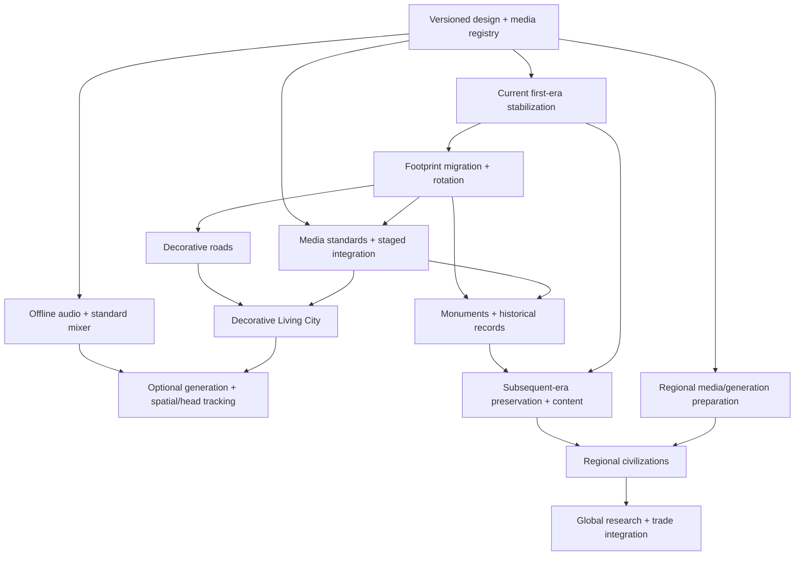

# Development roadmap

## Current authority — permanent protocol synchronization (19 November 2026)

Dima’s [Permanent Development and Coordination Protocol](docs/design/sources/2026-11-19-permanent-development-protocol.md) (source **P1**) is the latest direct instruction. Only the consolidated ChatGPT **Civilization** project `g-p-f352f14f77788191b45d2e1e092aa7e7` is used for coordination. Legacy projects are historical evidence only; do not retrieve instructions independently from them. Use the dedicated **Civilization — Master Development Coordination** conversation recorded in DESIGN_SYNC.md, never select a chat merely by recency.

The current assignment is documentation synchronization and a real coordination request **before further features**. Human = Product Owner/final authority; ChatGPT = Game Designer/Project Architect/Roadmap Coordinator; Codex = Engineering Lead. Both game and media remain in Git. Complete, enjoyable, polished Stone Age remains the immediate product milestone. Implementation completion is not human acceptance.

Current implementation baseline: game `4d4211e` on `first-era-review`; media `697b486` on `main`. Geometry foundation and decorative roads are delivered for review. Recorded latest evidence: 148 Debug / 137 Release core tests, five Release exclusion probes, 13 UI tests on each of three profiles; signed iPhone update installed with fresh production-validated backup and both saves byte-identical before normal launch. Physical road usability, sustained performance and art/enjoyment acceptance remain open. These are prior milestone results, not fresh tests in this documentation cycle.

The current register at the top of DEVELOPMENT_ROADMAP.md supersedes historical pending-install/no-roads/no-geometry/next-stage statements below. New relocation, road editing, three-state HUD, independent saves and geography feedback is approved for specification; it is not implemented by this sync. No second era, additional playable cities, warfare, monetization, backend, renderer replacement, save reset or catalog rescaling is authorized. Preserve existing local branch; do not automatically merge or push.

Synchronized19November2026 from [baseline](DESIGN_BASELINE.md) and [decision register](DESIGN_DECISIONS.md). This is a dependency-aware delivery plan, **not a claim that future features are implemented**. Stage labels below are planning IDs, not a finalized marketing/version/era schedule. Synchronization/media foundation is complete; current task prioritizes first-era player understanding and completion. Exact feature briefs, open decisions and migrations precede each implementation stage.

## Current delivery register (P1)

This register supplies current status, priority, dependencies, acceptance, milestone, approval and implementation references for every decision item. The descriptions and detailed requirements in DESIGN_DECISIONS.md and the S0–S10 stage sections remain authoritative parts of each row. Historical stages below preserve scope/evidence; this register governs current scheduling. Allowed statuses: Proposed, Approved, Ready, In Progress, Awaiting Human Review, Accepted, Blocked, Deferred. P0 = synchronize now, P1 = first-era usability/save safety, P2 = staged first-era expansion/media, P3 = future. Approved is a requirement awaiting a bounded brief; Ready means sufficiently specified for the current authorized task. No product milestone is marked Accepted without explicit human acceptance.

Current authorized milestone: **COORD-001 / S0 P1 synchronization only**. Candidate next milestone is S1-UX relocation/roads/HUD polish, pending the master reply and reconciliation. S1-Saves and S1-Geography are later bounded first-era submilestones; exact scheduling awaits coordination. These labels do not change the app version. S2 is partial (geometry foundation only), S3 is delivered awaiting review, S4–S7 remain staged, S8–S10 deferred. Geometry foundation was sufficient for S3 without activating larger sizes/rotation UI. Road delivery supersedes the old strict “finish S2 before S3” sequence.

| ID / description | Status | Priority | Dependencies | Acceptance criteria | Target milestone | Approval reference | Implementation commit / evidence |
|---|---|---|---|---|---|---|---|
| SYNC-001 — Versioned five-document baseline before code; conversation memory is not a complete spec (S1) | Awaiting Human Review | P2 | P1 protocol | Verify this requirement against S0 acceptance below; preserve CORE-002; human review distinct from test delivery. | S0 | Existing decision-register source; P1 preserves direction | c9ecdd4; media 697b486 |
| CORE-001 — SwiftUI/SpriteKit/pure Swift, iOS18universal landscape, deterministic core and protected normal saves (S1/prior direct instructions) | Awaiting Human Review | P1 | CORE-002 | Verify this requirement against S1 acceptance below; preserve CORE-002; human review distinct from test delivery. | S1 | Existing decision-register source; P1 preserves direction | 4d4211e baseline; first-era milestone reports |
| CORE-002 — Persistent geography, IDs, rewards/readiness; no silent revocation (S1/prior0.2.7) | Awaiting Human Review | P1 | CORE-002 | Verify this requirement against S1 acceptance below; preserve CORE-002; human review distinct from test delivery. | S1 | Existing decision-register source; P1 preserves direction | 4d4211e baseline; first-era milestone reports |
| ERA-001 — All active progression catalog buildings/technologies, required resource discovery, five pillars (direct0.2.7) | Awaiting Human Review | P1 | CORE-002 | Verify this requirement against S1 acceptance below; preserve CORE-002; human review distinct from test delivery. | S1 | Existing decision-register source; P1 preserves direction | 4d4211e baseline; first-era milestone reports |
| GOAL-001 — Seven measurable chapters and out-of-order credit, no duplicate historical rewards (direct0.2.7) | Awaiting Human Review | P1 | CORE-002 | Verify this requirement against S1 acceptance below; preserve CORE-002; human review distinct from test delivery. | S1 | Existing decision-register source; P1 preserves direction | 4d4211e baseline; first-era milestone reports |
| PLAY-002 — Dima explicitly approves catalog-derived starter-material reserve protection: reject only spending that strands missing basic suppliers; actual costs/rates unchanged | Awaiting Human Review | P1 | CORE-002 | Verify this requirement against S1 acceptance below; preserve CORE-002; human review distinct from test delivery. | S1 | Existing decision-register source; P1 preserves direction | 3ecc846, ec36baf |
| PLAY-001 — Dima prioritizes start/understand/complete first era over looks/roads/NPCs; contextual optional dependency guidance and existing-screen navigation | Awaiting Human Review | P1 | CORE-002 | Verify this requirement against S1 acceptance below; preserve CORE-002; human review distinct from test delivery. | S1 | Existing decision-register source; P1 preserves direction | 62767da, 7047d38 |
| UI-001 — Compact expandable aligned Building/Research cards, icon costs, individual red deficits (direct feedback) | Awaiting Human Review | P1 | CORE-002 | Verify this requirement against S1 acceptance below; preserve CORE-002; human review distinct from test delivery. | S1 | Existing decision-register source; P1 preserves direction | 60e3268 |
| FP-001 — Individually balanced dimensions, rectangles and rotation (S1) | Approved | P2 | S1; Q-FP-1/2 | Verify this requirement against S2 acceptance below; preserve CORE-002; human review distinct from test delivery. | S2 | Existing decision-register source; P1 preserves direction | 70418ea, d0a3284 foundation only; dimensions/UI pending |
| FP-002 — Unique immovable1×1fireplace, existing `campfire` identity (S1/R1) | Awaiting Human Review | P2 | S1; Q-FP-1/2 | Verify this requirement against S2 acceptance below; preserve CORE-002; human review distinct from test delivery. | S2 | Existing decision-register source; P1 preserves direction | 70418ea; fixed campfire regression |
| FP-003 — Uniform4×4reported design starting point (S1) | Proposed | P2 | S1; Q-FP-1/2 | Resolve discrepancy/proposal explicitly before activation; no catalog or save mutation from examples. | S2 | Existing decision-register source; P1 preserves direction | — |
| FP-004 — Rotation uses90degree steps; saved dimensions/orientation per instance (planning suggestion) | Proposed | P2 | S1; Q-FP-1/2 | Resolve discrepancy/proposal explicitly before activation; no catalog or save mutation from examples. | S2 | Existing decision-register source; P1 preserves direction | — |
| RD-001 — Footpath/dirt/primitive stone,1tile strips,4-way16masks, drag, save/remove/upgrade (S1) | Awaiting Human Review | P2 | geometry foundation | Verify this requirement against S3 acceptance below; preserve CORE-002; human review distinct from test delivery. | S3 | Existing decision-register source; P1 preserves direction | 4ed64ac, 24fd575; road report 4d4211e |
| RD-002 — Initially decorative/free; must not gate era progression (S1) | Awaiting Human Review | P2 | geometry foundation | Verify this requirement against S3 acceptance below; preserve CORE-002; human review distinct from test delivery. | S3 | Existing decision-register source; P1 preserves direction | 4ed64ac, 24fd575; road report 4d4211e |
| RD-003 — Transport/trade/NPC path preference/building connectivity (S1) | Deferred | P3 | geometry foundation | Verify this requirement against S3 acceptance below; preserve CORE-002; human review distinct from test delivery. | S3 | Existing decision-register source; P1 preserves direction | — |
| RD-004 — N=1/E=2/S=4/W=8; no diagonals; road command batching/tier borders (planning) | Awaiting Human Review | P2 | geometry foundation | Verify this requirement against S3 acceptance below; preserve CORE-002; human review distinct from test delivery. | S3 | Existing decision-register source; P1 preserves direction | 4ed64ac, 24fd575; road report 4d4211e |
| LC-001 — Decorative population-proportional diverse agents; building activities, road preference/open land; markets/animals (S1) | Approved | P2 | S2/S3/S4; measured headroom | Verify this requirement against S5 acceptance below; preserve CORE-002; human review distinct from test delivery. | S5 | Existing decision-register source; P1 preserves direction | — |
| LC-002 — Exact NPC caps, update rates, demographic proportions, wildlife collisions (planning) | Proposed | P2 | S2/S3/S4; measured headroom | Resolve discrepancy/proposal explicitly before activation; no catalog or save mutation from examples. | S5 | Existing decision-register source; P1 preserves direction | — |
| MED-001 — Separate local Civilization-Media Git repo, master/runtime separation, provenance/license/backlog (S1) | Awaiting Human Review | P2 | P1 protocol | Verify this requirement against S0 acceptance below; preserve CORE-002; human review distinct from test delivery. | S0 | Existing decision-register source; P1 preserves direction | c9ecdd4; media 697b486 |
| ART-001 — Historically inspired realism, high saturation/sharp detail/materials/warm light (S1) | Approved | P2 | S0; size-sensitive exports S2 | Verify this requirement against S4 acceptance below; preserve CORE-002; human review distinct from test delivery. | S4 | Existing decision-register source; P1 preserves direction | — |
| ART-002 — Keep SpriteKit; choose raster or modeling sources per approved future pipeline (S1) | Approved | P2 | S0; size-sensitive exports S2 | Verify this requirement against S4 acceptance below; preserve CORE-002; human review distinct from test delivery. | S4 | Existing decision-register source; P1 preserves direction | — |
| LOAD-001 — Logo/app icon,2–3era illustrations, phone/tablet native framing, separate progress/logo/localized text (S1) | Approved | P2 | S0; size-sensitive exports S2 | Verify this requirement against S4 acceptance below; preserve CORE-002; human review distinct from test delivery. | S4 | Existing decision-register source; P1 preserves direction | — |
| AUDIO-001 — Offline audio production with commercial-use source/license evidence, procedural/AI assets (S1) | Approved | P2 | S0; API/license feasibility | Verify this requirement against S7 acceptance below; preserve CORE-002; human review distinct from test delivery. | S7 | Existing decision-register source; P1 preserves direction | — |
| AUDIO-002 — Optional on-device generative audio / supported Apple acceleration, caching, Off/Automatic/On and resource limits (S1) | Approved | P2 | S0; API/license feasibility | Verify this requirement against S7 acceptance below; preserve CORE-002; human review distinct from test delivery. | S7 | Existing decision-register source; P1 preserves direction | — |
| AUDIO-003 — Native spatial audio with standard fallback (S1) | Approved | P2 | S0; API/license feasibility | Verify this requirement against S7 acceptance below; preserve CORE-002; human review distinct from test delivery. | S7 | Existing decision-register source; P1 preserves direction | — |
| AUDIO-004 — AirPods personalization/head tracking where supported (S1) | Approved | P2 | S0; API/license feasibility | Verify this requirement against S7 acceptance below; preserve CORE-002; human review distinct from test delivery. | S7 | Existing decision-register source; P1 preserves direction | — |
| AUDIO-005 — Physical acoustic simulation (S1) | Deferred | P3 | S0; API/license feasibility | Verify this requirement against S7 acceptance below; preserve CORE-002; human review distinct from test delivery. | S7 | Existing decision-register source; P1 preserves direction | — |
| AUDIO-006 — Master/music/nature/city/SFX/interface levels and advanced settings (S1) | Approved | P2 | S0; API/license feasibility | Verify this requirement against S7 acceptance below; preserve CORE-002; human review distinct from test delivery. | S7 | Existing decision-register source; P1 preserves direction | — |
| WND-001 — Era-specific monument catalog (S1) | Approved | P2 | S2/S4; Q-WND-1/2 | Verify this requirement against S6 acceptance below; preserve CORE-002; human review distinct from test delivery. | S6 | Existing decision-register source; P1 preserves direction | — |
| WND-002 — Monument models/textures (S1) | Approved | P2 | S2/S4; Q-WND-1/2 | Verify this requirement against S6 acceptance below; preserve CORE-002; human review distinct from test delivery. | S6 | Existing decision-register source; P1 preserves direction | — |
| WND-003 — Visible multi-stage construction (S1) | Approved | P2 | S2/S4; Q-WND-1/2 | Verify this requirement against S6 acceptance below; preserve CORE-002; human review distinct from test delivery. | S6 | Existing decision-register source; P1 preserves direction | — |
| WND-004 — Permanent landmarks at original locations across eras (S1/S4human) | Approved | P2 | S2/S4; Q-WND-1/2 | Verify this requirement against S6 acceptance below; preserve CORE-002; human review distinct from test delivery. | S6 | Existing decision-register source; P1 preserves direction | — |
| WND-005 — Completion celebrations (S1) | Approved | P2 | S2/S4; Q-WND-1/2 | Verify this requirement against S6 acceptance below; preserve CORE-002; human review distinct from test delivery. | S6 | Existing decision-register source; P1 preserves direction | — |
| WND-006 — Historical construction records (S1) | Approved | P2 | S2/S4; Q-WND-1/2 | Verify this requirement against S6 acceptance below; preserve CORE-002; human review distinct from test delivery. | S6 | Existing decision-register source; P1 preserves direction | — |
| WND-007 — Heritage/tourism mechanics (S1) | Deferred | P3 | S2/S4; Q-WND-1/2 | Verify this requirement against S6 acceptance below; preserve CORE-002; human review distinct from test delivery. | S6 | Existing decision-register source; P1 preserves direction | — |
| WND-CAND — Temple of Ancestors / Celestial Circle / Ancestral Burial Mound (S1/S4) | Proposed | P2 | S2/S4; Q-WND-1/2 | Resolve discrepancy/proposal explicitly before activation; no catalog or save mutation from examples. | S6 | Existing decision-register source; P1 preserves direction | — |
| GEO-001 — Region choice per new civilization (S1, S4“Approved path”) | Deferred | P3 | S8; Q-GEO-1/2 | Verify this requirement against S9 acceptance below; preserve CORE-002; human review distinct from test delivery. | S9 | Existing decision-register source; P1 preserves direction | — |
| GEO-002 — Regional landscape generation (same) | Deferred | P3 | S8; Q-GEO-1/2 | Verify this requirement against S9 acceptance below; preserve CORE-002; human review distinct from test delivery. | S9 | Existing decision-register source; P1 preserves direction | — |
| GEO-003 — Regional architecture packs, shared mechanics/variant lookup (same) | Deferred | P3 | S8; Q-GEO-1/2 | Verify this requirement against S9 acceptance below; preserve CORE-002; human review distinct from test delivery. | S9 | Existing decision-register source; P1 preserves direction | — |
| GEO-004 — Regional resources/wildlife (same) | Deferred | P3 | S8; Q-GEO-1/2 | Verify this requirement against S9 acceptance below; preserve CORE-002; human review distinct from test delivery. | S9 | Existing decision-register source; P1 preserves direction | — |
| GEO-005 — Regional monuments (same) | Deferred | P3 | S8; Q-GEO-1/2 | Verify this requirement against S9 acceptance below; preserve CORE-002; human review distinct from test delivery. | S9 | Existing decision-register source; P1 preserves direction | — |
| GEO-006 — Regional music/soundscapes (same) | Deferred | P3 | S8; Q-GEO-1/2 | Verify this requirement against S9 acceptance below; preserve CORE-002; human review distinct from test delivery. | S9 | Existing decision-register source; P1 preserves direction | — |
| GEO-007 — Shared global scientific knowledge/research inheritance (same) | Deferred | P3 | S9; Q-TRADE-1 | Verify this requirement against S10 acceptance below; preserve CORE-002; human review distinct from test delivery. | S10 | Existing decision-register source; P1 preserves direction | — |
| GEO-008 — Inter-civilization trade (same) | Deferred | P3 | S9; Q-TRADE-1 | Verify this requirement against S10 acceptance below; preserve CORE-002; human review distinct from test delivery. | S10 | Existing decision-register source; P1 preserves direction | — |
| ERA-002 — Later historical eras preserve geography/landmarks (S1/S3/S4) | Deferred | P3 | human first-era acceptance; Q-ERA-1 | Verify this requirement against S8 acceptance below; preserve CORE-002; human review distinct from test delivery. | S8 | Existing decision-register source; P1 preserves direction | — |
| BOUND-001 — No warfare, monetization, backend or renderer replacement under current work (S1/prior scope) | Approved | P0 | P1 protocol | Verify this requirement against S0 acceptance below; preserve CORE-002; human review distinct from test delivery. | S0 | Existing decision-register source; P1 preserves direction | — |
| COORD-001 — Permanent canonical cycle and dedicated master coordination chat | In Progress | P0 | SYNC-001 | All six docs reconciled; both Git states recorded; request actually sent or complete fallback supplied; stable chat identity recorded. | S0 | P1 | — |
| MOVE-001 — Individual availability indicators for every relocation footprint tile | Approved | P1 | FP-002, CORE-002 | Each tile independently reflects terrain/discovery/occupancy; overall core validity remains atomic and matches preview. | S1-UX | P1 | — |
| MOVE-002 — Footprint-only dragging for relocation | Approved | P1 | MOVE-001 | Drag initiates only within effective footprint; outside touches retain camera behavior; phone/tablet pan and pinch regressions pass. | S1-UX | P1 | — |
| MOVE-003 — Automatic valid relocation and remain in mode on invalid release | Approved | P1 | MOVE-001, MOVE-002 | Valid release commits once for free; invalid release retains active preview/mode and leaves saved origin/resources unchanged; campfire fixed. | S1-UX | P1 | — |
| MOVE-004 — Bottom-center relocation cancellation | Approved | P1 | MOVE-003 | Reachable labeled Cancel at bottom center on phone/tablet; cancels preview without changing building/saves. | S1-UX | P1 | — |
| RD-005 — Road stroke reversal and individual tile removal | Approved | P1 | RD-001, CORE-002 | Specify reversal vs retrace before code; reverse preview deterministically; individual removal survives reload; free atomic editing/cancel and mixed joins preserved. | S1-UX | P1 | — |
| HUD-001 — Compact goals HUD with three display states | Approved | P1 | GOAL-001, PLAY-001 | Agree exact three states; switch all states accessibly on phone/tablet with chapter/progress/action guidance retained and map readable. | S1-UX | P1 | — |
| HUD-002 — Explore icon beside goals icon | Approved | P1 | HUD-001 | Adjacent accessible goals/Explore controls open existing exploration without losing or committing another preview. | S1-UX | P1 | — |
| HUD-003 — Move Roads into Build menu | Approved | P1 | RD-001, UI-001 | Road tools discoverable in Build; remain separate from 20 progression building types; preserve road edit/placement/cancel behavior. | S1-UX | P1 | — |
| SAVE-001 — New game and independent saves | Approved | P1 | CORE-002, DEV-001 | Specify slot ownership/selection; create/reload/switch independent normal games without overwriting existing progress; atomic migration and offline/reward isolation verified. | S1-Saves | P1 | — |
| DEV-001 — Separate developer and regular player experiences | Approved | P1 | CORE-001, CORE-002 | Preserve isolated developer store and Release exclusions; ordinary new-game flow has no scenario/grant/reset controls; slot switching cannot mix histories. | S1-Saves | P1 | Existing Debug isolation at 4d4211e; regular-flow refinement pending |
| MAP-001 — Larger persistent geographical maps | Approved | P2 | CORE-002, SAVE-001 | Approve size/performance and legacy migration policy; reload preserves geography/IDs/landmarks/occupied tiles; no forced existing-save replacement. | S1-Geography | P1 | — |
| MAP-002 — Accessible stone quarry on settlement side of river | Approved | P1 | MAP-001, PLAY-001 | Quarry is reachable for legitimate first-era discovery/extraction without a bridge; preserve existing deposit IDs and player investments in old saves. | S1-Geography | P1 | — |
| MAP-003 — Cloud-covered unexplored territory | Approved | P2 | MAP-001, MED-001 | Clouds hide unknown content without leaks; readable discovery edges and reduced-motion/performance fallback; no construction on hidden land. | S1-Geography | P1 | — |
| MAP-004 — Expedition-based territory discovery | Awaiting Human Review | P1 | CORE-002 | Retain expedition cost/time/discovery persistence; define larger-map adaptation; cancel/reload/offline never duplicates cost or reveals unexplored content early. | S1-Geography | P1; existing exploration milestones | Existing expedition foundation at 4d4211e; larger-map work pending |
| MAP-005 — Geographical expansion across historical eras | Deferred | P3 | MAP-001, ERA-002 | Approve era expansion rules before delivery; geography/landmarks/history survive; no second-era gameplay activated in current cycle. | S8 | P1 | — |

S1-UX exit: satisfy MOVE-001–004, RD-005 and HUD-001–003 under a reconciled bounded brief; core/save/road atomicity and all affected phone/mini/Pro gesture suites pass, normal save preserved, physical evidence reported only when observed. S1-Saves exit: SAVE-001/DEV-001 migration, independent histories and Release exclusions verified. S1-Geography exit: MAP-001–004 meet approved geometry/migration/art/performance policy with existing-world preservation. None is started by this documentation change. Retain FP/LC/AUDIO/WND/GEO and subsequent civilization interactions/trade as approved long-term backlog; future scope is not deleted.

## Stage delivery metadata

The detailed stage descriptions/acceptance below and requirement rows above jointly define each stage. P1 preserves all prior approvals; “Deferred” changes scheduling, not approval. All implementation references are local commits.

| Stage | Status | Priority | Dependencies / gate | Approval reference | Implementation reference |
|---|---|---|---|---|---|
| S0 synchronization/media | In Progress | P0 | Canonical review; master request approval/delivery | P1, S1 original sync | c9ecdd4; media 697b486; current sync pending commit |
| S1 first-era candidate | Awaiting Human Review | P1 | Historical acceptance criteria below; S1-UX follows reconciled brief | Direct playability approval; P1 | 62767da, 7047d38, 3ecc846, ec36baf; current evidence 4d4211e |
| S1-UX feedback | Approved | P1 | COORD-001 reply/reconciliation; Q-MOVE/RD/HUD | P1 | — |
| S1-Saves | Approved | P1 | Q-SAVE-1 migration/UX brief | P1 | Debug isolation only at 4d4211e; independent slots absent |
| S1-Geography | Approved | P2 | Q-MAP-1; save compatibility; measured budget | P1 | Expedition foundation only at 4d4211e |
| S2 dimensions/rotation | Approved | P2 | Q-FP-1/2; legacy preservation; directional art | S1 original approval | 70418ea, d0a3284 foundation only |
| S3 decorative roads | Awaiting Human Review | P1 | Current geometry; physical usability review pending | Direct move-on approval after ed23e2e | 4ed64ac, 24fd575, 4d4211e |
| S4 media/branding/loading | Approved | P2 | Bounded pilot; Dima visual review; dimension-dependent exports S2 | S1 original approval; P1 ART target | Existing candidate/media 697b486; target not delivered |
| S5 Living City | Approved | P2 | S2/S3/S4; hardware headroom; bounded pilot | S1 original approval; P1 preservation | — |
| S6 monuments | Approved | P2 | S2/S4; Q-WND-1/2 | S1 original approval; P1 preservation | — |
| S7 audio | Approved | P2 | Rights, API/model feasibility; fallback first | S1 original approval; P1 preservation | — |
| S8 subsequent eras | Deferred | P3 | Human first-era acceptance; explicit era authorization | Approved future direction only | — |
| S9 regional civilizations | Deferred | P3 | S8; ownership/global-knowledge rules | S1 original approval; P1 preservation | — |
| S10 global research/trade | Deferred | P3 | S9; explicit sharing/transfer rules | S1 original approval; P1 preservation | — |

## Dependency outline

Arrows describe meaningful prerequisites, not permission to build parallel systems now. Simple branding/loading production and offline audio may proceed independently after bounded briefs; they do not require waiting for NPCs. Monuments do not require a complete NPC economy. Global/local research semantics must be decided before enabling multiple selectable civilizations even though final integration is listed last. No renderer rewrite is required by this roadmap.

## S0 — Design synchronization and media foundation (this task)

Deliver the five root design documents, source excerpts with access limits, updated entry points and separate Civilization-Media repository. Import only already-accessible originals with checksums/provenance; configure local LFS and no remote. Preserve existing app runtime copies and history. Register absent concepts/media as missing/backlog rather than placeholders claimed complete. Regional/era/variant keys are media metadata; no speculative regional gameplay engine.

Acceptance: all workstreams/IDs trace to a human requirement or marked proposal; actual1×1/2×2footprints and access gaps documented; media registry/license entries resolve; master hashes match game originals; LFS objects validate; two clean Git repos; game changes are documentation only.

## S1 — First-era completion, stabilization and evidence (active priority)

Dima explicitly prioritizes start/understand/complete. Add optional contextual prerequisite/action guidance where current chapters leave an instructional gap (knowledge producer is a later-chapter objective). Preserve real costs and chapters; no automatic purchase or visual/road/NPC expansion. Implement via the [playability plan](docs/superpowers/plans/2026-11-19-first-era-playability.md).

Baseline: implemented game source at60e3268, documentation throughfea9e16and this sync. Keep gameplay/art unchanged except confirmed defects. Reconcile existing artifacts rather than repeating measurements without a reason.

Tasks:

1. Run the **complete five-test UI suite** on phone/mini/Pro after the final title reservation; prior full suites precede it, final targeted tests follow it.
2. Consolidate legitimate serial/efficient and reasonable casual-script routes against the current config: chapter timestamps, cost waits, construction/research intervals, gross/net stocks, population/workers, discovery/access and action gaps. Current90/154minute evidence is scripted simulation, not real casual-play observation; do not relabel the route without defining its policy.
3. Preserve all115Debug/104Release historical regressions and5Release probes. Rerun core tests if code/config changes; for documentation-only evidence consolidation, cite the verified run/commit rather than claim a fresh run.
4. Reuse rendering/node/texture/startup evidence where unchanged; address confirmed critical defects. Investigate dense~48FPS hardware result when a device is available, without claiming the unmeasured final cache change achieved60FPS.
5. On iPhone reconnection: fresh copy/production validation of normal+developer saves, signed update, post-install byte/semantic comparison and launch. Do not uninstall/reset. Document any ordinary elapsed-time change separately from data loss.
6. Deliver evening review package with explicit art fidelity gap under the new direction and absent future workstreams. Human review does not become “passed” because automation succeeds.

Acceptance: all three current full UI suites pass; all catalog requirements and historical rewards remain reachable/sticky; no critical blocker/save regression; real-cost progression timings/recovery evidence recorded; simulator/hardware/human claims separated; newest update installed with preservation evidence **when hardware is available**, otherwise deployment remains visibly pending. No substantial tuning silently applied.

## S2 — Variable footprints and rotation

Depends on S1compatibility baseline. Before implementation, settle Q-FP-1/2 and approve a per-type footprint table. The old “uniform4×4” description is not the actual input: two1×1types and eighteen2×2types are current. Keep campfire1×1and immovable.

Affected seams: `BuildingDefinition.tiles(at:)`, bounds/occupancy/site checks in GameEngine, nearby-resource range calculations, save validation/migration in GamePersistence, GameSession placement/relocation, MapGeometry/SettlementScene previews/hit testing and catalog footprint text. Current PlacedBuilding has no rotation/footprint version, and validation resolves current catalog dimensions; editing JSON first would risk overlapping/rejected old saves.

Proposed deliverable: resolve effective footprint/orientation consistently in one core geometry path, with a migration design that preserves legacy instance origins/covered tiles (per-instance snapshot or versioned legacy definitions are alternatives, not a finalized choice). Then author new-building dimensions/rotation controls and compatible directional art/anchors. A2×3test rectangle is a geometry fixture, not an approved building size.

Acceptance: non-square rotation placement/move/inspection/ghost/reload agree; blocked rotation/canceled placement does not charge or mutate; rectangular bounds, water/forest/hills/discovery and self-overlap rules hold; original layouts/IDs/timers/rewards/population/geography remain valid; no forced relocation/demolition; immutable campfire; phone/tablet gesture regressions and ordinary full-era playthrough pass.

## S3 — Decorative roads

Depends on S2’s effective occupancy/rotation protocol and a small road brief resolving Q-RD-1/2. Road art pilot may be prepared earlier after S0, but do not serialize an unstated mask protocol.

Deliver three decorative road tiers, one-tile strokes/parallel strips, sixteen four-way visual combinations, drag preview/build/remove/upgrade, persistent data and incremental neighbor updates. Retain free initial construction and no production/transport bonus. Keep roads separate from required progression building types, or explicitly demonstrate an equivalent non-gating catalog policy. Functional networks are not part of this stage.

Acceptance: all16masks verified, neighboring joins update after editing/upgrading/reload; mixed-tier and terrain/entrance rules documented; stroke/cancel behavior explicit and deterministic; no unintended economy change/era requirement; no fog leak; existing saves migrate with no roads and normal buildings unchanged; road drag vs map pan/building drag is deliberate on phone/tablet; batch previews remain within measured frame/memory budgets.

## S4 — Staged media integration and branding/loading

Foundation S0; dimension-sensitive building exports depend on S2. Start with a representative approved realism/material/lighting pilot rather than regenerate everything blindly. Existing masters remain recoverable. Source import is separate from art acceptance and runtime integration.

Deliver approved-direction guides, prioritized building/terrain/road exports, actual thumbnails/icons, logo/app icon and2–3StoneAge loading compositions in phone/tablet native landscape framing. Reuse source render layers and align art anchors with actual effective footprints/rotations. Progress/logo/localized text stay native/separate. Regional/era variant fallback is a small explicit asset-resolution interface once needed, not duplicate mechanics.

Acceptance: source/license/provenance entries and checksums present; runtime export traceable to immutable master/media commit; correct alpha/scale/anchors/legibility under pan/zoom; no missing bundled assets if media repo is absent; loader/progress ready-state intact; aspect crops and safe areas verified; no baked text/progress in backgrounds; performance/texture budgets measured on available hardware; visual direction reviewed by Dima.

## S5 — Decorative Living City, NPCs and animals

Depends on effective occupancy (S2), decorative roads (S3), selected media (S4) and verified performance headroom (S1). Prototype one small decorative activity loop first, then cap and diversify. Do not couple individual actors to core workforce accounting.

Deliver population-proportional capped actor counts; age/body/appearance variation; farming/crafting/gathering/social/trading activities near actual appropriate sites; decorative market merchants/customers; road preference with open-terrain traversal; wildlife/domestic animals/environment animations. Define market visual anchors without silently adding a new economic building type. Respect hidden terrain, water/blocked occupancy, pause/background and reduce-motion settings.

Acceptance: actors reflect population/activity without creating resource/worker side effects; no actor on undiscovered/prohibited locations; routes remain stable across building/road edits and save/reload; absence of roads is recoverable; representative diversity visible; no per-frame authoritative economy; bounded spawn/update/path budgets, graceful device-quality downgrade and stress tests. Actual economic integration remains deferred.

## S6 — Monuments and historical construction

Depends on footprints/migration (S2), media assets (S4) and a decided WND catalog/progression policy. NPC celebrations may enhance it after S5 but are not a prerequisite for persistent monument state. Audio celebration can use later standard fallback.

WND-001catalog +002models/textures →003staged construction →004original-location permanence +006history →005celebrations. WND-007heritage/tourism remains deferred. The three StoneAge examples are candidates; dimensions/costs/era mapping and unique-vs-repeatable policy need approval. Check available geography before committing large examples.

Acceptance: staged timing/costs atomic and save-safe; original location/era/date/history preserved across planned transitions; construction/reload cannot duplicate rewards; locked/decorative/ordinary/monument categories are clear; no silent change to existing sticky readiness or new-player era requirements; no city re-layout requirement; celebrations bounded and accessible. Cross-era retention can be tested with fixtures before any second-age content ships.

## S7 — Audio production, fallback mixer and advanced options

AUDIO-001offline licensed/procedural/AI pipeline and AUDIO-006basic channel controls can start after S0under a bounded brief. Spatial emitters need world coordinates/activity anchors and performance budgets from S1/S5. They are independent of adding a new age.

First deliver master/music/nature/city/SFX/interface levels and reliable conventional playback, lifecycle/route/interruption behavior, generated/exported assets and license records. Then feasibility-gate AUDIO-002local generation with supported Apple acceleration/caches; AUDIO-003native spatial; AUDIO-004AirPods personalization/head tracking; AUDIO-005physical acoustics; advanced AUDIO-006policies/settings. Verify current official Apple API/OS/device support at that stage; the recovered chat’s framework claims are unverified design suggestions, not platform guarantees.

Acceptance: standard fallback on all supported devices; Off/Automatic/On genuinely control generation; Off releases generation work, Automatic observes a documented thermal/battery/memory/frame policy, On still respects safety limits; cache limits/eviction deterministic; no audio work stalls simulation/rendering; external assets have proven commercial-use rights/attribution; volume channels/mute persist; route/unsupported-headphone/failure behavior tested; no direct unsupported AirPods-chip control or mandatory model.

## S8 — Subsequent eras

Depends on accepted first-era scope, safe catalog/save/footprint evolution (S2/S6) and a separately approved next-era content/requirements brief. NPC/audio optional features must not become implicit progression gates. Historical lists from earlier chats are proposals, not finalized era boundaries.

Acceptance: useful prior buildings/achievements/geography preserved; no reset or forced demolition; monuments remain where built; transition/prerequisites/rewards idempotent; consistent knowledge/application rules; full replay/save compatibility; explicit approval for the actual next era before implementation. No warfare/more cities/monetization inferred from historical brainstorms.

## S9 — Regional civilizations

Prepare regional **asset metadata** now (S0); generate/render one reference variant without multiplying mechanics when its bounded stage starts. Full selectable-region delivery waits for approved multi-civilization save ownership, era/local development and global research semantics (Q-GEO-1). S8and regional world/asset validation provide a stable foundation; no procedural replacement of existing reference saves.

GEO-001selector +002persistent regional geography +003architecture +004resources/wildlife +005monuments +006soundscapes. Candidate eight-region list is retained; approve the first shipping subset and region/era/culture mapping separately. Regional geography remains stable for each civilization after creation. Fallback to reference art where variants are missing is proposed, not a license to portray every region identically as final.

Acceptance: each civilization keeps independent IDs/stocks/population/map/history; shared mechanic IDs with explicit asset variants; deterministic saved map identity/generation inputs; no accidental resource mixing or invalidation of the original valley; historic landmarks preserved; no duplicated economic rules just to select art. No backend/multiplayer required by this direction.

## S10 — Global research and inter-civilization trade

Depends on S9’s independently persisted civilizations and explicitly approved sharing/transfer rules. Settle knowledge semantics before enabling multiple active civilizations; finish GEO-007inheritance and GEO-008trade integration here. A shared global research record is not automatic free local construction/materials or a mandatory global era lock.

Acceptance: global knowledge idempotent and provenance/history retained; local unlock/application requirements explicit; transfers conserve quantities and respect local stocks/capacity with atomic save/reload/offline accounting; no duplication on replay; region selection does not mutate old economies; compatible migration for the original single settlement; route-road function only when separately activated/approved. Exact rates, limits and economic incentives are design proposals until decided.

## Exit and commitment policy

Each stage ends in a local coherent commit, tests for affected behavior, updated implementation status/media provenance and a bounded review report. A documentation sync commit precedes implementation changes. Do not mark stage delivery/human acceptance complete from ChatGPT report-based acceptance. No dates, final costs, per-building sizes, NPC counts, next-era definitions or model technologies are silently finalized by this roadmap.

## S1current outcome and next dependency

Optional actionable guidance and legitimate recommendation-following progression are implemented; [quality assessment](docs/milestones/first-era-playability.md) records104–121minute full routes, waits/resources/workforce, recovery and126Debug/115Release/9UI-per-profile evidence. No economy values or final requirements changed. Before secondary features, retain approved PLAY-002 starter reserve protection and normal save protection and complete physical installation when access returns. S1functional guided-route verification is delivered; no blanket acceptance of every spending choice, human pacing or unavailable hardware.

## Current execution — geometry foundation

Dima authorized starting the bounded next geometry task after0b6b738. Implement shared rectangular/oriented geometry and optional new-building dimension snapshots, retaining existing square catalogs and player experience. Follow docs/superpowers/plans/2026-11-19-building-geometry.md. Legacy geometry activation/migration policy, larger sizes, rotation art/UI, roads and NPCs remain subsequent bounded stages.

Geometry foundation delivered: shared occupied geometry and additive optional snapshots for new construction; current catalog/art unchanged, legacy nil fields not rewritten. Full135Debug/124Release,5Release probes,9UI/profile verification recorded in [delivery report](docs/milestones/building-geometry-foundation.md). No larger-size/live-rotation/road/NPC activation; legacy conversion policy remains a prerequisite. Physical installation awaits device access/fresh backup.

## Current authorization — decorative roads

Dima directly instructs “Report to ChatGPT and move on” after geometryed23e2e. Implement the bounded approved decorative-road direction on existing dimensions, per docs/superpowers/specs/2026-11-19-decorative-roads-design.md and plan. Default terrain/no-overlap/mixed-material/free explicit paint/erase rules are documented Codex implementation choices, not recovered human quotations. Geometry stability is sufficient; unapproved larger dimensions remain deferred. No NPC, era or economy expansion. Commit this scope before product changes.

## Decorative roads delivered

Dima’s direct move-on instruction authorized the bounded road stage aftered23e2e. Spec/choices2bd4997 and ChatGPT reconciliation6659754 precede product implementation4ed64ac. Free separate road data/tools, three per-tile styles,16derived cardinal masks, gap-free preview, Draw/Replace/Remove, explicit Confirm/Cancel, mixed joins and local renderer invalidation are implemented. Discovered open land/no overlap, explicit removal before buildings and atomic invalid-stroke rejection are documented implementation choices. Roads do not affect economy or era requirements. Missing legacy fields remainnil/empty without rewrite;v5retained. [Milestone](docs/milestones/decorative-roads.md) records148Debug/137Release,5Release probes,13UI/profile, native captures and simulator-only performance evidence. Current building dimensions/raster art unchanged; NPCs, live rotation and larger sizes remain staged. Phone reconnected: final signed update installed after fresh validated backup; both saves byte-identical before normal launch, which succeeds. Physical usability/performance is still pending.
