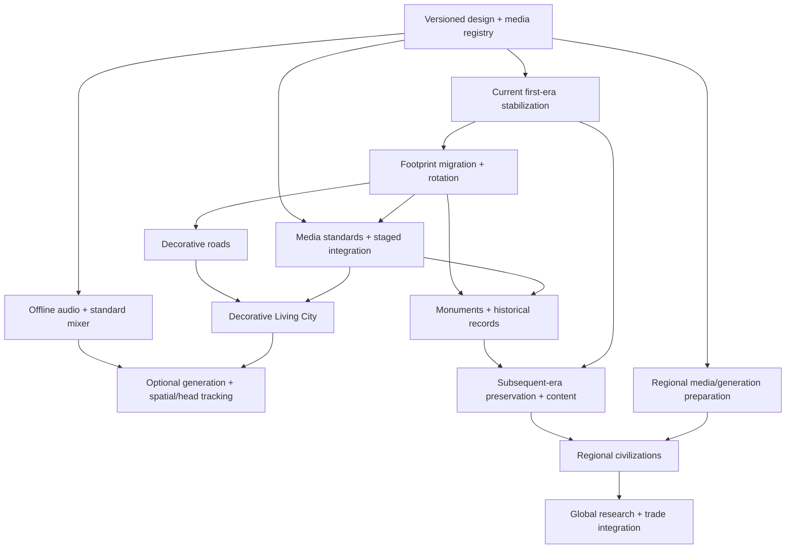

# Development roadmap

Synchronized19November2026 from [baseline](DESIGN_BASELINE.md) and [decision register](DESIGN_DECISIONS.md). This is a dependency-aware delivery plan, **not a claim that future features are implemented**. Stage labels below are planning IDs, not a finalized marketing/version/era schedule. Current task executes only synchronization and media-repo setup. Exact feature briefs, open decisions and migrations precede each implementation stage.

## Dependency outline

Arrows describe meaningful prerequisites, not permission to build parallel systems now. Simple branding/loading production and offline audio may proceed independently after bounded briefs; they do not require waiting for NPCs. Monuments do not require a complete NPC economy. Global/local research semantics must be decided before enabling multiple selectable civilizations even though final integration is listed last. No renderer rewrite is required by this roadmap.

## S0 — Design synchronization and media foundation (this task)

Deliver the five root design documents, source excerpts with access limits, updated entry points and separate Civilization-Media repository. Import only already-accessible originals with checksums/provenance; configure local LFS and no remote. Preserve existing app runtime copies and history. Register absent concepts/media as missing/backlog rather than placeholders claimed complete. Regional/era/variant keys are media metadata; no speculative regional gameplay engine.

Acceptance: all workstreams/IDs trace to a human requirement or marked proposal; actual1×1/2×2footprints and access gaps documented; media registry/license entries resolve; master hashes match game originals; LFS objects validate; two clean Git repos; game changes are documentation only.

## S1 — First-era completion, stabilization and evidence (active priority)

Dima explicitly prioritizes start/understand/complete. Add optional contextual prerequisite/action guidance where current chapters leave an instructional gap (knowledge producer is a later-chapter objective). Preserve real costs and chapters; no automatic purchase or visual/road/NPC expansion. Implement via the [playability plan](docs/superpowers/plans/2026-11-19-first-era-playability.md).

Baseline: implemented game source at60e3268, documentation throughfea9e16and this sync. Keep gameplay/art unchanged except confirmed defects. Reconcile existing artifacts rather than repeating measurements without a reason.

Tasks:

1. Run the **complete five-test UI suite** on phone/mini/Pro after the final title reservation; prior full suites precede it, final targeted tests follow it.
2. Consolidate legitimate serial/efficient and reasonable casual-script routes against the current config: chapter timestamps, cost waits, construction/research intervals, gross/net stocks, population/workers, discovery/access and action gaps. Current90/154minute evidence is scripted simulation, not real casual-play observation; do not relabel the route without defining its policy.
3. Preserve all115Debug/104Release historical regressions and5Release probes. Rerun core tests if code/config changes; for documentation-only evidence consolidation, cite the verified run/commit rather than claim a fresh run.
4. Reuse rendering/node/texture/startup evidence where unchanged; address confirmed critical defects. Investigate dense~48FPS hardware result when a device is available, without claiming the unmeasured final cache change achieved60FPS.
5. On iPhone reconnection: fresh copy/production validation of normal+developer saves, signed update, post-install byte/semantic comparison and launch. Do not uninstall/reset. Document any ordinary elapsed-time change separately from data loss.
6. Deliver evening review package with explicit art fidelity gap under the new direction and absent future workstreams. Human review does not become “passed” because automation succeeds.

Acceptance: all three current full UI suites pass; all catalog requirements and historical rewards remain reachable/sticky; no critical blocker/save regression; real-cost progression timings/recovery evidence recorded; simulator/hardware/human claims separated; newest update installed with preservation evidence **when hardware is available**, otherwise deployment remains visibly pending. No substantial tuning silently applied.

## S2 — Variable footprints and rotation

Depends on S1compatibility baseline. Before implementation, settle Q-FP-1/2 and approve a per-type footprint table. The old “uniform4×4” description is not the actual input: two1×1types and eighteen2×2types are current. Keep campfire1×1and immovable.

Affected seams: `BuildingDefinition.tiles(at:)`, bounds/occupancy/site checks in GameEngine, nearby-resource range calculations, save validation/migration in GamePersistence, GameSession placement/relocation, MapGeometry/SettlementScene previews/hit testing and catalog footprint text. Current PlacedBuilding has no rotation/footprint version, and validation resolves current catalog dimensions; editing JSON first would risk overlapping/rejected old saves.

Proposed deliverable: resolve effective footprint/orientation consistently in one core geometry path, with a migration design that preserves legacy instance origins/covered tiles (per-instance snapshot or versioned legacy definitions are alternatives, not a finalized choice). Then author new-building dimensions/rotation controls and compatible directional art/anchors. A2×3test rectangle is a geometry fixture, not an approved building size.

Acceptance: non-square rotation placement/move/inspection/ghost/reload agree; blocked rotation/canceled placement does not charge or mutate; rectangular bounds, water/forest/hills/discovery and self-overlap rules hold; original layouts/IDs/timers/rewards/population/geography remain valid; no forced relocation/demolition; immutable campfire; phone/tablet gesture regressions and ordinary full-era playthrough pass.

## S3 — Decorative roads

Depends on S2’s effective occupancy/rotation protocol and a small road brief resolving Q-RD-1/2. Road art pilot may be prepared earlier after S0, but do not serialize an unstated mask protocol.

Deliver three decorative road tiers, one-tile strokes/parallel strips, sixteen four-way visual combinations, drag preview/build/remove/upgrade, persistent data and incremental neighbor updates. Retain free initial construction and no production/transport bonus. Keep roads separate from required progression building types, or explicitly demonstrate an equivalent non-gating catalog policy. Functional networks are not part of this stage.

Acceptance: all16masks verified, neighboring joins update after editing/upgrading/reload; mixed-tier and terrain/entrance rules documented; stroke/cancel behavior explicit and deterministic; no unintended economy change/era requirement; no fog leak; existing saves migrate with no roads and normal buildings unchanged; road drag vs map pan/building drag is deliberate on phone/tablet; batch previews remain within measured frame/memory budgets.

## S4 — Staged media integration and branding/loading

Foundation S0; dimension-sensitive building exports depend on S2. Start with a representative approved realism/material/lighting pilot rather than regenerate everything blindly. Existing masters remain recoverable. Source import is separate from art acceptance and runtime integration.

Deliver approved-direction guides, prioritized building/terrain/road exports, actual thumbnails/icons, logo/app icon and2–3StoneAge loading compositions in phone/tablet native landscape framing. Reuse source render layers and align art anchors with actual effective footprints/rotations. Progress/logo/localized text stay native/separate. Regional/era variant fallback is a small explicit asset-resolution interface once needed, not duplicate mechanics.

Acceptance: source/license/provenance entries and checksums present; runtime export traceable to immutable master/media commit; correct alpha/scale/anchors/legibility under pan/zoom; no missing bundled assets if media repo is absent; loader/progress ready-state intact; aspect crops and safe areas verified; no baked text/progress in backgrounds; performance/texture budgets measured on available hardware; visual direction reviewed by Dima.

## S5 — Decorative Living City, NPCs and animals

Depends on effective occupancy (S2), decorative roads (S3), selected media (S4) and verified performance headroom (S1). Prototype one small decorative activity loop first, then cap and diversify. Do not couple individual actors to core workforce accounting.

Deliver population-proportional capped actor counts; age/body/appearance variation; farming/crafting/gathering/social/trading activities near actual appropriate sites; decorative market merchants/customers; road preference with open-terrain traversal; wildlife/domestic animals/environment animations. Define market visual anchors without silently adding a new economic building type. Respect hidden terrain, water/blocked occupancy, pause/background and reduce-motion settings.

Acceptance: actors reflect population/activity without creating resource/worker side effects; no actor on undiscovered/prohibited locations; routes remain stable across building/road edits and save/reload; absence of roads is recoverable; representative diversity visible; no per-frame authoritative economy; bounded spawn/update/path budgets, graceful device-quality downgrade and stress tests. Actual economic integration remains deferred.

## S6 — Monuments and historical construction

Depends on footprints/migration (S2), media assets (S4) and a decided WND catalog/progression policy. NPC celebrations may enhance it after S5 but are not a prerequisite for persistent monument state. Audio celebration can use later standard fallback.

WND-001catalog +002models/textures →003staged construction →004original-location permanence +006history →005celebrations. WND-007heritage/tourism remains deferred. The three StoneAge examples are candidates; dimensions/costs/era mapping and unique-vs-repeatable policy need approval. Check available geography before committing large examples.

Acceptance: staged timing/costs atomic and save-safe; original location/era/date/history preserved across planned transitions; construction/reload cannot duplicate rewards; locked/decorative/ordinary/monument categories are clear; no silent change to existing sticky readiness or new-player era requirements; no city re-layout requirement; celebrations bounded and accessible. Cross-era retention can be tested with fixtures before any second-age content ships.

## S7 — Audio production, fallback mixer and advanced options

AUDIO-001offline licensed/procedural/AI pipeline and AUDIO-006basic channel controls can start after S0under a bounded brief. Spatial emitters need world coordinates/activity anchors and performance budgets from S1/S5. They are independent of adding a new age.

First deliver master/music/nature/city/SFX/interface levels and reliable conventional playback, lifecycle/route/interruption behavior, generated/exported assets and license records. Then feasibility-gate AUDIO-002local generation with supported Apple acceleration/caches; AUDIO-003native spatial; AUDIO-004AirPods personalization/head tracking; AUDIO-005physical acoustics; advanced AUDIO-006policies/settings. Verify current official Apple API/OS/device support at that stage; the recovered chat’s framework claims are unverified design suggestions, not platform guarantees.

Acceptance: standard fallback on all supported devices; Off/Automatic/On genuinely control generation; Off releases generation work, Automatic observes a documented thermal/battery/memory/frame policy, On still respects safety limits; cache limits/eviction deterministic; no audio work stalls simulation/rendering; external assets have proven commercial-use rights/attribution; volume channels/mute persist; route/unsupported-headphone/failure behavior tested; no direct unsupported AirPods-chip control or mandatory model.

## S8 — Subsequent eras

Depends on accepted first-era scope, safe catalog/save/footprint evolution (S2/S6) and a separately approved next-era content/requirements brief. NPC/audio optional features must not become implicit progression gates. Historical lists from earlier chats are proposals, not finalized era boundaries.

Acceptance: useful prior buildings/achievements/geography preserved; no reset or forced demolition; monuments remain where built; transition/prerequisites/rewards idempotent; consistent knowledge/application rules; full replay/save compatibility; explicit approval for the actual next era before implementation. No warfare/more cities/monetization inferred from historical brainstorms.

## S9 — Regional civilizations

Prepare regional **asset metadata** now (S0); generate/render one reference variant without multiplying mechanics when its bounded stage starts. Full selectable-region delivery waits for approved multi-civilization save ownership, era/local development and global research semantics (Q-GEO-1). S8and regional world/asset validation provide a stable foundation; no procedural replacement of existing reference saves.

GEO-001selector +002persistent regional geography +003architecture +004resources/wildlife +005monuments +006soundscapes. Candidate eight-region list is retained; approve the first shipping subset and region/era/culture mapping separately. Regional geography remains stable for each civilization after creation. Fallback to reference art where variants are missing is proposed, not a license to portray every region identically as final.

Acceptance: each civilization keeps independent IDs/stocks/population/map/history; shared mechanic IDs with explicit asset variants; deterministic saved map identity/generation inputs; no accidental resource mixing or invalidation of the original valley; historic landmarks preserved; no duplicated economic rules just to select art. No backend/multiplayer required by this direction.

## S10 — Global research and inter-civilization trade

Depends on S9’s independently persisted civilizations and explicitly approved sharing/transfer rules. Settle knowledge semantics before enabling multiple active civilizations; finish GEO-007inheritance and GEO-008trade integration here. A shared global research record is not automatic free local construction/materials or a mandatory global era lock.

Acceptance: global knowledge idempotent and provenance/history retained; local unlock/application requirements explicit; transfers conserve quantities and respect local stocks/capacity with atomic save/reload/offline accounting; no duplication on replay; region selection does not mutate old economies; compatible migration for the original single settlement; route-road function only when separately activated/approved. Exact rates, limits and economic incentives are design proposals until decided.

## Exit and commitment policy

Each stage ends in a local coherent commit, tests for affected behavior, updated implementation status/media provenance and a bounded review report. A documentation sync commit precedes implementation changes. Do not mark stage delivery/human acceptance complete from ChatGPT report-based acceptance. No dates, final costs, per-building sizes, NPC counts, next-era definitions or model technologies are silently finalized by this roadmap.
