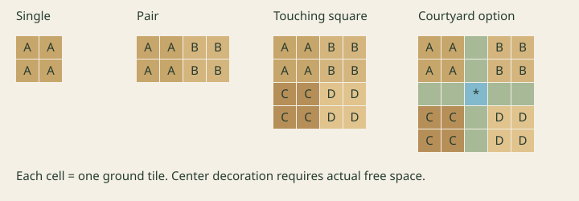
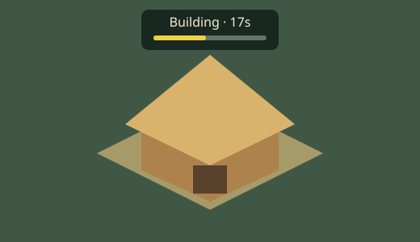

# City layout and usability — human feedback, 19 November 2026

Status: backlog documentation authorized; implementation and exact neighborhood economics not authorized by this request. Preserve active S1-Saves → S1-Geography → environment graphics sequence. Seed 0.6 is a suggested label only.

## CLU-001 — Sprite footprint (human feedback)
Hut artwork appears larger than its 2×2 tile footprint. Correct ground-plane scale, anchor, perspective and preview consistency without changing catalog dimensions or saved occupancy. Roof height may project beyond the footprint. Test zoom, pan, selection, adjacency and relocation.

## CLU-002 — Neighborhoods (human direction; mechanics proposed)
Two connected residences or four arranged in a square should form a small neighborhood. Human suggested +5 capacity or a shared decorative centerpiece (fountain/statue). Designer proposed +5 for a pair and +10 for a square, and a shared decoration slot; whether cumulative, exact values, grouping, connectivity, costs and physical space require approval. Support future residential types and upgrades, regional art and era-appropriate fire pits, sacred stones, gardens, statues and fountains. No road requirement or progression gate; existing decorative road semantics unchanged.

### Grid references (each character is one ground tile)
```text
Single       Pair        Four touching     Courtyard alternative
AA           AABB        AABB              AA.BB
AA           AABB        AABB              AA.BB
                         CCDD              ..*..
                         CCDD              CC.DD
                                           CC.DD
```
A–D = individual 2×2 residences; dot = free tile; * = candidate decoration tile. Four touching residences consume all 16 tiles: a physical centerpiece cannot occupy their middle without overlap. Courtyard alternative requires explicit space and rule approval. Never silently grant extra terrain or overlap occupancy.



## CLU-003 — Construction and selection (human feedback; designer proposal)
Screenshot: Gathering shelter Lv1 selected while global Storytelling circle construction panel shows 17s remaining. Investigate whether intentional global HUD versus stale selection state; do not assert root cause. Replace large overlay with compact building-anchored progress/time; selected construction details belong in its own inspector. Selection of other buildings must not show unrelated detail. Independent indicators, cleanup on completion, no implicit concurrent construction gameplay unlock.


## CLU-004 — Inspector polish (designer proposal)
Compact vertical spacing, scrollable content, fixed header/close, consolidate workforce/staffing, compact priority selector; safe areas and touch targets on iPhone/iPad.

## Delivery and acceptance
High priority: CLU-001,003,004; medium: neighborhood detection, bonuses, decorations; low: visual variants. Reconcile with existing FP/MOVE/HUD/UX IDs (CLU avoids collisions); preserve all prior approved/deferred items. Before implementation publish bounded brief, confirm scheduling and economy/occupancy decisions. Test pair/square/diagonal/irregular clusters, overlapping-group exploit prevention, upgrades/move/delete/reload, independent timers and unrelated selection, clipping and safe areas; no save reset, catalog rescale, economy activation or second-era implementation without authorization.

Source references: human Neighborhood Building Layout and current city UI conversation, 19 November 2026. Original screenshot attachments are not yet copied to Git; SVGs are new schematic references, not original screenshots or runtime assets.
