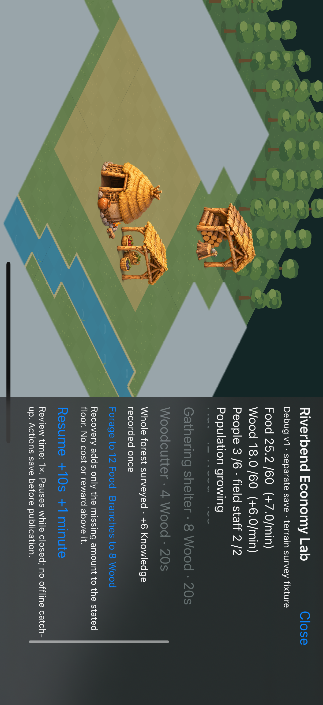
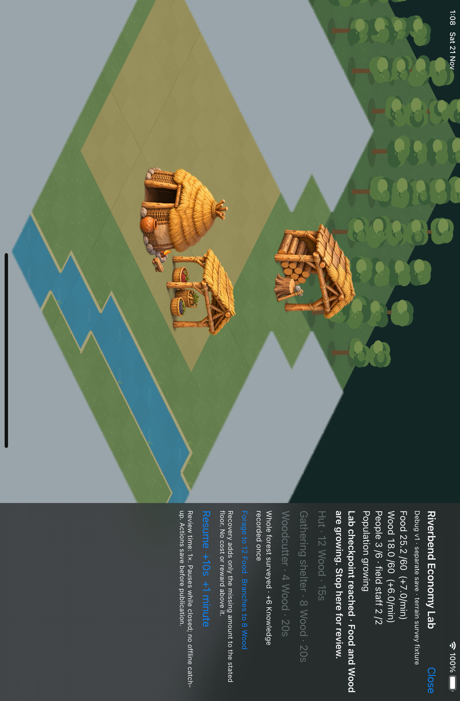

# Goal 1 — Riverbend Economy Lab

Delivered for **Lab review**, not production adoption or human acceptance. Branch `economy-lab-review`, exact base `a598da71c5315eb021d77c44e8d6bc4ec290e7c5`; fetched instructions `origin/main` `3e1faa1ca9b350d1de918e83bd7610ab0128f1cd` without merging. Product commit: `5001588eab83299475f28076fb3e670c83fbb02d`. Evidence: [verification manifest](../testing/economy-lab/verification.json), [implementation decisions](../superpowers/plans/2026-11-21-economy-lab.md).

Open **Developer tools → Open separate Food and Wood lab**. Profile `riverbend-economy-lab-v1` starts with3residents/32Food/32Wood and no Water flow or HUD row. Hut12Wood/+3housing, Gathering Shelter8Wood/+8Food/min, Woodcutter4Wood/+6Wood/min. Campfire2Food/min/3housing; people consume1Food/min each. Existing native placement, construction durations, rates, worker allocation and growth use GameEngine. Two field workers remain available during the survey. One Hut and one of each producer bound this short review route.

The completed Hut offers a60second/8Food survey alongside the optional Gathering Shelter. The adapter reuses the existing whole-component forest proposal on unchanged real seed terrain; no live area-expedition API or production fog migration is claimed. Costs are shown before commitment. Choose a proposed site, cycle alternatives, tap/drag freely and confirm legal placement. Free recoveries add only missing Food to12 or Wood to12before the first Hut/8afterward. Build/reveal/payment/recovery/time commands atomically save a validated candidate before publishing it. Reload preserves paid survey progress and its once-only6Knowledge, without extra debit or reveal.

Lab storage is `Application Support/RiverbendDebugLabs/riverbend-economy-lab-v1/lab.json`; a QA library ID adds a separate test directory. It never loads an existing player's settlement. Corrupt/failed lab initialization fails visibly; there is no silent reset or normal-game fallback. Closing/backgrounding pauses this prototype; reopening applies **no offline catch-up**. Explicit10second/minute advances are review controls.

## Verification actually run

| Check | Actual result |
|---|---|
| Checked-in runner full core | **288Debug /235Release passed**, plus **13Debug-present/Release-absent API probes**, report9cbe932 |
| Final focused lab after stronger discovered-land reachability assertion | **9passed**, reportcc6a7d; two fallback origins reachable through revealed open terrain |
| Final native Debug phone+iPad | **1phone +1mini passed**, iPhone16Pro/iOS18.6 and iPadMiniA17Pro/iOS18.6, reporte1eb457; final gesture-and-reload route |
| Ordinary native Release entry/persistence and explicit Lab entry absence | **1passed** on iPhone17ProMax/iOS26.5, report7b91aa9; later UI fixes are entirely Debug-guarded |
| Python toolkit | **42passed /3skipped**; skipped art audit fixtures require a sibling media checkout unavailable in this managed worktree. No art change depends on them. |
| Source integrity | Seed SHA256 `5c812367c320b1060fd93f3b07af64b942b20d8c679a73b5b62bc6d4b5b9f25d`; seed/art/GameSession/persistence/app-entry source unchanged; `git diff --check` passed |

Nine Lab tests exercise exact costs/upkeep/growth/caps, delayed and depleted starts, insufficient survey funds, worker independence, cardinal forest contiguity and discovered-land reachability, occupied primary/fallback sites, invalid transactions, retry/reload, failed payment and completion publication, wrong/corrupt envelopes, and authentic Normal/Developer/connected-Round2/library fixture bytes. Original fixture files remain byte-identical. No physical save data was accessed.

The final native gesture route checks pan retention across running ticks, roof-tap origin stability, retained-offset one-tile dragging without camera movement, actual Hut/survey/Woodcutter/Gatherer completion, mid-survey reopening, once-only Knowledge, positive Food/Wood rates, app relaunch persistence and return to normal entry. Screenshots are unchanged full-screen XCTest PNGs, not synthetic views.

## Ten-minute deterministic engine trace

This uses actual original construction durations (Hut15s, Woodcutter20s, Gatherer20s), not the foundation's model-only example schedule. Native review controls use their explicitly selected increments.

| Elapsed seconds | Event | Food | Wood | People | Food net/min | Wood net/min |
|---:|---|---:|---:|---:|---:|---:|
|0|Start|32|32|3|-1|0|
|15|Hut complete|31.75|20|3|-1|0|
|15|Survey paid|23.75|20|3|-1|0|
|75|Whole forest revealed|22.75|20|3|-1|0|
|95|Woodcutter complete|22.4167|16|3|-1|6|
|115|Gatherer complete|22.0833|10|3|7|6|
|600|Minute10|60|58.5|5|5|6|

## Failures and corrections retained

The original baseline helper was terminated after a process sample identified pre-existing unbounded polling in `cancelledLargePreviewPreparationDoesNotPublishOrWriteNormalSave`; it could miss a transient flag and spin forever. Deterministic pre-start cancellation now verifies nonpublication and original bytes; full suite passes. This test covers cancellation before launch, not a controlled midpoint in expensive preparation.

Sandbox-only attempts failed required Swift cache access. Re-running with authorized host cache access succeeded. Initial Lab RED proved missing API; the first implementation failed profile validation because removing civic levels inherited Campfire rotation; the lab now pins it to its existing north orientation.

Native aggregateeeb734f contains phone**zero tests/failed** and mini**1passed**; it is not a passing aggregate. Later phone465d8e reproduced camera snap after a running tick; refitting is now confined to initial/explicit selection. Phone39df5c reproduced roof-tap origin18,12→17,11; preview footprint/body hits now preserve origin. Those failures and separate simulator Busy/launch refusals0f6cd1/834634e remain archived. Phone5c04b7 passed an earlier route body, so it is not credited with new roof coverage. A separate persistent Lab cache and renamed gesture case verify the final assertions. The first cropped mini `app.screenshot()` is not readability evidence; final captures use `XCUIScreen.main.screenshot()`.

Independent review found these two important UI defects; both were reproduced RED and corrected, with final native results above. Its minor persistent-map accessibility wording issue was corrected. Food/Wood readouts are fixed above the scrolling controls after screenshot inspection exposed a clipped Food row. No deferred review finding is hidden.

## Rulings and limits

- Existing approved foundation plus direct autonomous execution supplies design authorization; routine lab choices are recorded in the plan. Cost if wrong: owner requests refinement at this review gate.
- Reuse the deterministic real-terrain region adapter, not a second production exploration implementation. Cost: this is fixture evidence, not production area-exploration readiness.
- One of each opening building,60second survey and pause-on-close/no-offline-catch-up bound this pilot. Cost: replaying broader settlements/offline economy requires a later approved slice.

No changes to ordinary economy/Water, save schemas, game library, existing Normal/Developer/Round2 progress, R2-07, normal appearance/onboarding/GateB, media/art, signing/accounts, main or Empire. No device install/reset/save injection, production activation, human enjoyment acceptance or physical performance claim. Registered raster/art/rotation remains unaccepted and independent.

**Stop here for Lab review.** Map Finds is not implemented. Only after the review gate clears may a fresh Goal2 context start from the exact verified pushed Lab handoff. Stone/storage/craft/first-era review each remain separate later goals.
