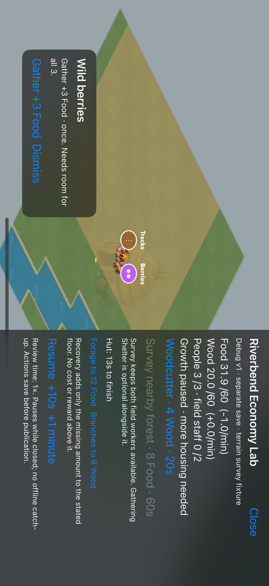
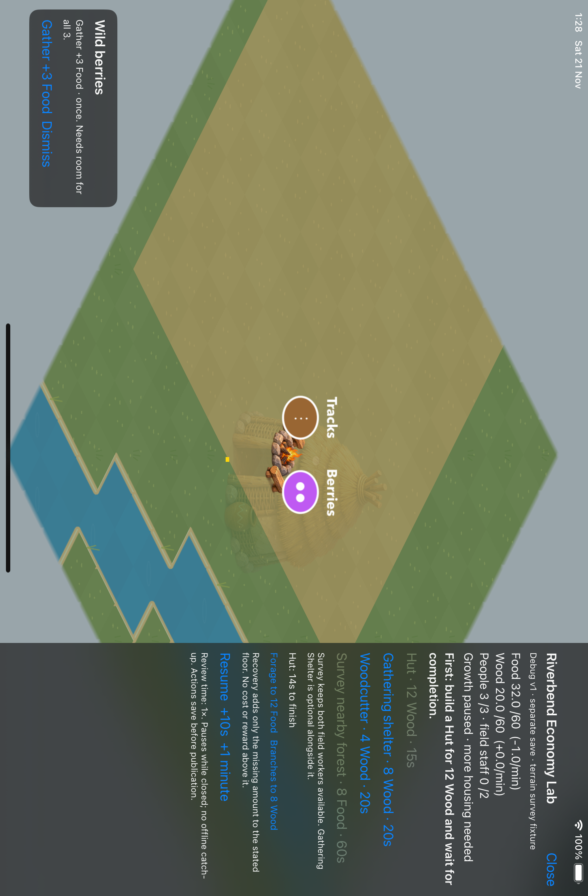

# Goal 2 — Riverbend Map Finds

Review-only successor to Goal 1. Product **3759351de18f000458eb5c909c69f709f9192ef8**. Exact base `d45dc0f34ac926ce661f95a958f5a493a362ddae`; branch `economy-map-finds-review` in the fresh managed worktree. Fetched `origin/main` `4ec56dc37cb54a39d454412c2257f8f7fdb7f3c3` without merging; referenced Map Finds and sequencing plans unchanged. Current direct overnight instruction supersedes Goal 1's human-playtest stop for these sequential Debug review goals. Human playtest/adoption remain separate.

## Behavior

Developer tools → Open separate Food and Wood lab. The first actual construction wait introduces two deterministic revealed-land review markers. Berries show **Gather +3 Food**, once; the full three units must fit or the patch stays intact with an explanation. Fresh deer tracks offer **Observe** only, recording a visible wildlife clue without reward, hunting, resource unlock, research or territory reveal. No Hunting fixture was required; no Meat item exists.

Find IDs, tiles and resolution persist in the existing isolated v1 lab envelope. Unresolved sites use a deterministic reachable/unoccupied/revealed-land fallback when construction blocks them, retaining their IDs. A previous Goal 1 envelope reads additively. Results and resolution share the existing validated atomic save-before-publication transaction. Failed writes retain the original in-memory state; a retry/relaunch/duplicate cannot pay again. Dismissal changes no find or resource state.

Map taps open a compact dismissible inspector. Placement owns its normal tap/drag route and hides the review markers; pan and pinch retain their existing ownership. No automatic camera focus on find appearance. The ordinary Lab route, depleted-stock recoveries, survey and progression stay independent; the original native gesture route ignores both finds.

## Verification

Final results and immutable reports/captures are pinned in [verification](../testing/map-finds/verification.json). The final full core run passed **295 Debug /235 Release** and **14 Debug-present/Release-absent probes** (`f65be6dd`). Seven focused model tests cover deterministic waits/sites, Gather/Observe, storage rejection/retry, fallback/stale/hidden taps, failed writes, exact-once reload, old-envelope compatibility and ignoring finds. Authentic Normal/Developer/connected-Round2/library fixtures are exercised through real library APIs and retain original bytes after both find actions.

Python toolkit:45 discovered,42 passed/3 skipped (sibling source-media-dependent art checks unavailable in this managed worktree). No art changes rely on them.

| Final check | Actual result |
|---|---|
| Full checked-in core runner |295 Debug /235 Release,14 exclusion probes passed; `f65be6dd` |
| Phone Debug |2 passed, iPhone16Pro/iOS18.6; `4fe8cfcb` step1 |
| iPad Debug |2 passed, iPadMiniA17Pro/iOS18.6; `4fe8cfcb` step2 |
| Ordinary native Release |1 passed, iPhone17ProMax/iOS26.5; `9b4b5884`, normal entry/persistence and Lab entry absent |
| Python toolkit |42 passed /3 skipped source-media art fixtures |
| Integrity |Normal source/seed/art/project unchanged against exact base; `git diff --check` passed |

Each Debug destination ran `testMapFindsWaitDismissGatherObserveAndReload` and independent `testEconomyLabGestureRouteAndReload`. These are actual nonzero executed cases, not inferred selection. The first verifies a real Hut wait, both pending markers, map tap/dismiss, reopening unresolved state, exact3Food payout, Observe, route completion, resolved app relaunch and return to ordinary map. The second retains roof-tap/offset-drag/pan assertions and completes the route without using finds. Eight full-screen XCTest PNGs are archived without pixel changes, with device/test/timestamp/export metadata.

[Phone Observe](../testing/map-finds/captures/phone-tracks.png), [iPad Observe](../testing/map-finds/captures/mini-tracks.png), [phone reload](../testing/map-finds/captures/phone-reload.png), [iPad reload](../testing/map-finds/captures/mini-reload.png), [phone ignore-both route](../testing/map-finds/captures/phone-ignore-finds.png), [iPad ignore-both route](../testing/map-finds/captures/mini-ignore-finds.png).

## Retained failures and review

Sandbox-only branch creation and simulator inventory initially hit host restrictions; the preauthorized host execution succeeded without changing permission configuration or signing. No checkout/native/push blocker remains at delivery preparation.

The initial model RED run failed for absent Map Finds APIs. Two subsequent compile attempts failed on Swift Testing's key-path `allSatisfy` macro expansion; an explicit closure corrected the test. The first occupied-site test assumed a two-by-two shelter could originate at any open one-tile find; it failed on actual footprint overlap. It now chooses a legal building origin whose footprint covers the find, and the fallback regression passes. These reports remain separate from passing results.

Independent review identified first-match touch selection when find hit disks overlap. First added pinch test `4719bc1c` passed without reaching overlap. Stronger native attempt `c9eaae04` failed its overlap precondition (36.754 points, required <22), not the marker-choice assertion; it is explicitly a failed native run. The unchanged first-match selector was extracted into the lab model and exact geometry test `mapFindsOverlappingTargetsSelectNearestNotFirst` reproduced the defect RED (`0883480b`). Nearest eligible selection now passes that test and the full suite (`f65be6dd`). Native UI tests also inspect Tracks with both pending, dismiss, then inspect Berries. Pinch attempts alone are not credited as proof of a measured zoom change.

Minor deferred from independent review: a later unresolved Berry fallback may coincide with an already observed Tracks tile, drawing both marker labels at one anchor. The Berry remains actionable and payout/resolution stay independent; review-marker layout refinement remains open. No broad appearance acceptance is claimed.

No ordinary economy/Water, GameCore engine, library/save schema, Normal/Developer/Round2 progress, R2-07, production onboarding/graphics, art/media, signing/accounts, main/Empire or device changes. No merge, install, physical data access or human enjoyment/performance claim.

## Tuning and review limits

The one-time3Food patch equals22.5seconds of the Gathering Shelter's8Food/min gross production. It adds a small buffer; the native route could already afford the8Food survey before gathering. It does not outperform sustained production or unlock the route. Observe pays nothing. Automated tests deliberately tap known coordinates, so spontaneous player noticing, distraction, perceived usefulness and enjoyment require human playtest. The captures establish visible labels/action wording and actual wait state, not those human outcomes.

Static review did not independently judge native geometry/visual quality or process termination during the filesystem's atomic replacement. Native captures were inspected separately for labels, action text and wait/readout visibility. No crash-in-the-write-window experiment or physical metrics are claimed. All predecessor evidence remains unchanged under `docs/testing/economy-lab`. The new archive preserves original runner JSON/Markdown and compressed raw logs, including unsuccessful attempts; the manifest maps original log hashes to their `.gz` copies.

**Goal 2 ends here.** [Goal 3 handoff](2026-11-21-stone-storage-handoff.md) is for a separate fresh context after the verified push. No Stone/storage work was started here.
