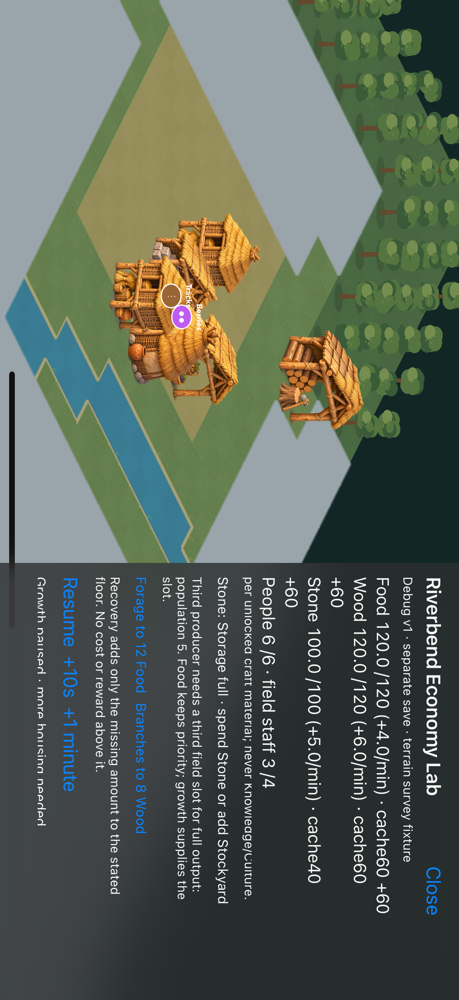
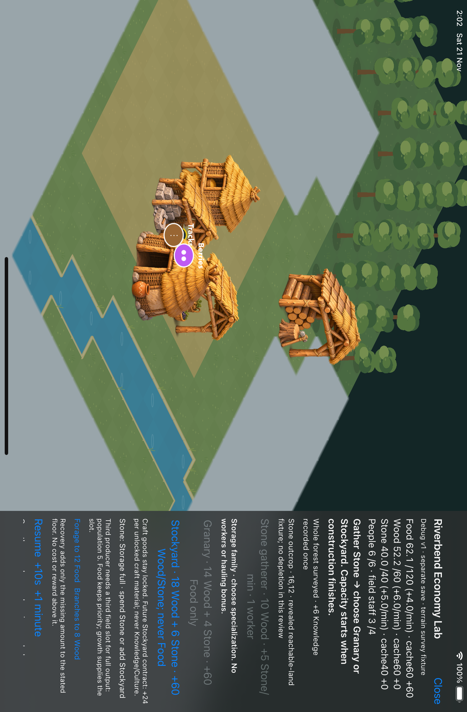

# Goal 3 — Riverbend Stone and Storage

Delivered for Debug Lab review only. Product **70886c20dc40a1501062c9387fe44bb76e8efb08**;
exact predecessor **fb068aba76ee4cc5104dbb9c696173d8b94bf75b**;
branch `economy-stone-storage-review` in the fresh managed worktree. Read fetched
main `4ec56dc37cb54a39d454412c2257f8f7fdb7f3c3` without merging. Direct overnight
authorization permits these sequential review goals without routine human-playtest
pauses; it does not approve production adoption.

After the unchanged Food/Wood checkpoint, **Reveal nearby Stone outcrop** freely
introduces a deterministic source on reachable already-revealed open land. Its
coordinates and existing deposit glyph identify a Lab fixture, not a new production
exploration system or changed terrain. One existing Stone gatherer costs **10 Wood**,
needs a nearby legal site and one field worker, and produces **5 Stone/min** when
fully staffed. Growth to population5 supplies a third field slot. Food retains
priority and worker limitation is visible. The outcrop has no depletion in this
bounded slice; no finite-reserve claim is made.

The existing storehouse family has two per-instance specializations, one each:

| Role | Cost | Capacity on completion |
|---|---|---|
| Granary |14 Wood +4 Stone |+60 Food only |
| Stockyard |18 Wood +6 Stone |+60 Wood and +60 Stone; never Food |

Base cache remains Food60/Wood60/Stone40. No tuning adjustment was necessary.
Readouts distinguish amount/cap, base cache and completed-building contribution.
Storage consumes no workers and grants no hauling bonus. Both projects provide
an actual Stone spending path; the opening, free recoveries and finds never
require Stone. Craft goods remain locked. Their future base24/Stockyard+24 contract
is documented for Goal4, not activated as a craft chain here.

Specialization metadata and the source are additive fields in the same isolated
v1 envelope. Old Goal1/Goal2 envelopes remain readable. Roles must correspond
exactly to actual storehouse IDs, with unique roles and IDs; malformed metadata
cannot create a hidden capacity grant or erase/reinterpret a storage building.
Capacity starts at completion, including when one time advance crosses that
boundary. The same validated atomic save-before-publication transaction covers
reveal, collect/time, build/spend and finds. No ordinary save/schema or library
changes occurred. The Lab remains pause-on-close, with no offline catch-up.

## Verification

[Immutable reports, hashes, source pins and all16native captures](../testing/stone-storage/verification.json).

| Final check | Actual result / report |
|---|---|
| Full core |**300 Debug /235 Release**, passed; `7efdb028` |
| Debug-present /Release-absent probes |**15 passed**, including storage role; same report |
| Phone Debug Stone/storage |**1 passed**, iPhone16Pro/iOS18.6; `ea762dae` |
| Phone Debug Food/Wood and Map Finds |**2 passed**, same phone; `daeb3bcb` |
| iPad Debug all three cases |**3 passed**, iPadMiniA17Pro/iOS18.6; `c840f1be` |
| Ordinary native Release |**1 passed**, iPhone17ProMax/iOS26.5; `aabbc8cc` |
| Python toolkit |**42 passed /3 skipped**,45 discovered; source-media-dependent art fixtures unavailable |
| Integrity |Protected engine/seed/library/persistence/project/renderer source byte-identical to exact base; `git diff --check` passed |

Five new model tests cover free reveal with insufficient gatherer funds; hidden
source rejection; independent Granary/Stockyard effects; exact10/14/18Wood and4/6Stone
charges; full40/100Stone intake behavior and spending/retry; mid-construction and
completed reload; split versus aggregate time; failed write/retry; malformed or
missing storage/source metadata; and old envelopes. The authentic Normal,
Developer, connected-Round2 and library fixture test now also exercises both
storage projects and collection before resolving finds, retaining every original
fixture file byte. Original Food/Wood and Map Finds regression suites pass.

Actual native routes build through the opening without using either find, reveal
Stone, collect to40, spend4Stone on Granary, reopen during its construction,
verify Food120/Wood60/Stone40, spend6Stone on Stockyard, then verify
Food120/Wood120/Stone100 and app relaunch persistence. Independent E0 gesture/reload
and E1 real-wait/dismiss/gather/observe/reload cases run on both profiles. Ordinary
Release confirms normal entry/persistence and absence of the Lab entry. Counts
are executed cases, not a zero-test selection or simulator build alone.

## Failures, corrections and limits

All11checked-in runner reports and compressed original logs are retained. Initial
new tests failed compilation for the missing feature APIs (`72c2a0eb`); the first
implementation passed its focused tests (`656de5bb`) and full core (`53deb81a`).
Independent review then found that the advertised free reveal included the
10Wood gatherer affordability check. The exact8Wood opening reproduced a real
one-test RED (`d342fa30`). Reveal now uses geometry-only eligibility; construction
retains its charge. Final full core passes and follow-up review found no remaining
important source/accounting issue.

First phone native attempt (`59144ce3`) reached40Stone but failed to hit Granary
after its test helper's full-page up/down swipes. It is not a passing route. Smaller
bounded scroll steps and omission of completed disabled opening buttons pass the
final phone/iPad routes. Placement/completion labels name each specialization;
growth explanations remain available. Sandbox-only branch creation and three
Swift-cache-dependent toolkit checks initially failed; authorized host retries
succeeded. A read-only screenshot after the failed native test timed out waiting
for screen surfaces; it supplies no capture evidence. Exact terminal-only gaps
are recorded separately in the evidence archive. Independent review's unsuccessful
standalone JIT linkage attempt is not credited as a test.

Minor display limits remain: the outcrop glyph can be occluded by existing
building/find sprites, although source coordinates and gathering action remain
visible; the full-cap hint can still suggest adding Stockyard after its one allowed
copy exists. This bounded review ends after the two projects. The inherited
Tracks/Berry fallback anchor overlap is unchanged. Stock/cap/contribution text is
visible in original phone/iPad captures; long lines wrap on compact width. Human
noticing, enjoyment, physical performance and crash-in-atomic-write-window behavior
are not established by these tests.

No storage removal/disconnect/upgrade is exposed, so no capacity-reduction or new
retained-overflow policy is introduced. Existing accumulated stock is retained
across completion, failure/retry and reload; full storage stops new intake. No
craft chain, ordinary economy/Water, production saves, migration, GameCore engine,
seed, art/media, renderer, signing/accounts, physical access/install, main merge,
Empire, GateB or R2-07 activation changed.

**Goal3 ends after its verified branch push.** The coordinator may open the fresh
[Goal4 one-craft context](2026-11-21-one-craft-handoff.md) from the exact final pushed
SHA. No craft implementation was started here.
