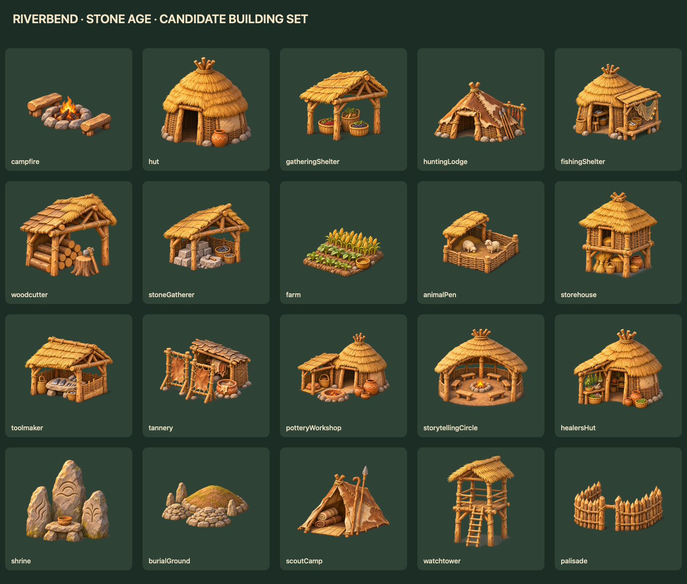
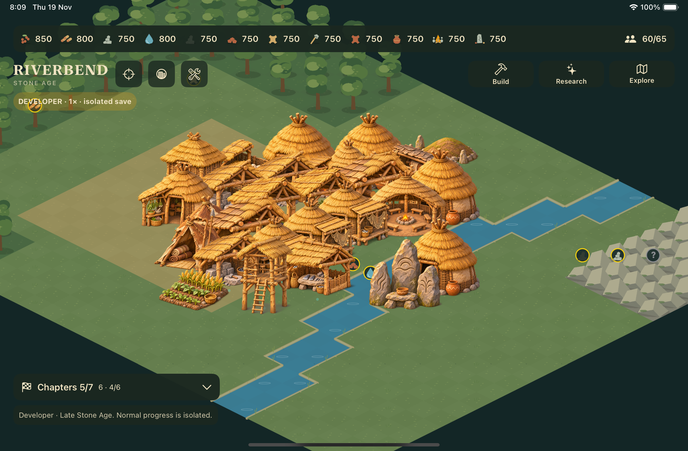
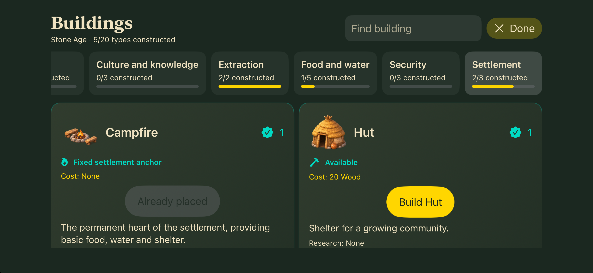

# First-era review candidate — 19 November 2026

The complete Stone Age candidate is implemented, locally versioned and installed on Dima’s iPhone for review. All seven measurable in-game chapters and catalog-derived era requirements remain complete and reachable through legitimate costs. Original replaceable artwork and presentation now cover the whole existing game. Permanent visual acceptance and human enjoyment belong to Dima’s review.

## Deliverables

- [Offline review gallery](../art/review.html), [all-building board](../art/building-board.png), [ChatGPT media brief](../art/chatgpt-first-era-brief.md), [production standards](../art/production-standards.md), [inventory](../art/asset-inventory.md) and [exact provenance/prompts](../art/provenance.json).
- Three original visual alternatives; warm miniature direction A integrated provisionally. All twenty building types have original transparent sprites and matching catalog thumbnails. Original research/resource/pillar icons cover20/12/5 identities. Original native terrain details cover grass/soil, trees, hills, riverbanks, reeds, water/deposits/fog; original loading panorama and restrained construction/placement/fire/smoke/water/production effects are integrated.
- ChatGPT’s external search-image examples cover each existing visual area and all twenty buildings. They are inspiration; no external reference image was copied into the application. Built-in image_gen created each building original and the three concepts; native SwiftUI/SpriteKit code supplies vector illustrations. Sources and prompts are retained. These are raster sprites, **not editable 3D models**.
- Manifest-based image paths, contact anchors, sizing, bounded caches and alpha hit masks keep the art replaceable. No renderer rewrite or permanent direction selection. SpriteKit, fixed geography, footprints, identifiers, campfire, savev5, rewards, gestures, iOS18 landscape and existing signing remain intact.







## Gameplay and pacing

Seed0.2.7’s complete catalog-derived requirements, sticky historical readiness/rewards, out-of-order chapters, original goal migration and developer scenario identity remain preserved. The [0.2.7 report](seed-0.2.7-report.md) records the exact seven historical onboarding goals and replacement design. The current journey is Founding, Nature, Agriculture, Craftsmanship, Society, Exploration/Protection and Stone Age completion. Goals retain visible compact progress when collapsed and measurable full detail.

The preserved paid serial playthrough completes in154 simulated minutes. Four additional ordinary-cost strategies finish in136/90/104/100minutes; the90minute route invests in a second storytelling circle and early Natural Knowledge. All complete20operational building types,20technologies,7chapters and5pillars, save/reload and pay for more construction afterward. Required-resource discovery does not demand the whole map or future resources. Actual advancement remains deferred.

A poor-priority recovery fork reaches zero wood after20offline minutes, then restores53.33wood through ordinary priorities and10offline minutes after save/reload, without grants, restart or population loss. Balance values remain unchanged. In-game knowledge guidance explains capacity/staffing choices. These tests demonstrate reachability and recovery, not an optimal route or human enjoyment; see [pacing evidence](../design/first-era-pacing-review.md).

## Correctness, usability and review fixes

Independent read-only review identified repeated economic calculations per building and misleading production pulses on zero-output housing/storage. Batched productive-building queries and a failing-then-passing regression fixed these. Final HUD resource/accessibility reads share one cached read-only economic overview per actual state; a refresh regression covers real construction/ticking. Authoritative simulation and numerical tuning are unchanged.

Larger artwork exposed a phone card action below the compact visible area. Moving the cost/action above secondary details restored access; unchanged placement/gesture tests pass. Developer pause freezes animation while retaining a drawable map for placement/inspection. Transparent sprite corners reject hits before the existing logical-footprint fallback. Reduce Motion disables ambient effects; background/hidden maps pause rendering. Smoke/ripples are bounded12/24; static scenery is flattened and source nodes released rather than rebuilt each tick.

## Verification evidence

| Check | Result |
|---|---|
| `swift test --package-path Packages/GameCore` |115tests passed; all historical regressions retained|
| `swift test --package-path Packages/GameCore -c release` |104tests passed|
| `python3 scripts/verify-developer-release.py` |5Debug APIs absent fromRelease, including isolated benchmark factory|
| `swift scripts/verify-art.swift` |All20sprite/thumbnail pairs, alpha, sizes and budget passed|
| Phone iPhone17ProMax /iOS26.5 UI |4tests passed|
| Mini A17Pro /iOS18.6 UI |4tests passed|
| Pro13 M4 /iOS18.6 UI |4tests passed|
| Signed Debug physical-device build |BUILD SUCCEEDED|
| Release simulator build |BUILD SUCCEEDED|
| Final signed iPhone install |Succeeded; no uninstall/reset/account change|

UI tests exercise immediate catalog selection→drag placement, chapter collapse/detail, locked catalog/scenario selection, dense art/research thumbnails, long-press relocation and pan/pinch identity. iOS18’s inspector-picker identifier limitation uses supported map reinspection; production gestures are unchanged. Native framebuffer captures are retained under `docs/screenshots/first-era-review`; XCTest attachment framing is unreliable on this simulator stack.

Representative reproducible UI command (simulator IDs are machine-specific):

```sh
xcodebuild -project Civilization.xcodeproj -scheme Civilization \
  -destination 'platform=iOS Simulator,id=EC995F2A-534A-4E57-A59C-0DE408729150' \
  -derivedDataPath /tmp/civilization-027-build CODE_SIGNING_ALLOWED=NO \
  -only-testing:CivilizationUITests/RelocationUITests test
```

Local full logs: `/tmp/civilization-first-era-debug.log`, `civilization-first-era-release.log`, `civilization-first-era-signed-build.log`, `civilization-first-era-release-build.log`. UI result bundles include `/tmp/civilization-first-era-phone-verified.xcresult`, `civilization-first-era-mini-final.xcresult`, `civilization-first-era-pro-final.xcresult` and final-cache phone rerun `civilization-first-era-cache-phone.xcresult`.

## Performance and physical preservation

| Sample | Observed result | Limit |
|---|---|---|
| Dense mini simulator before flattening |~6,800nodes;286–351MiB;42–48FPS|Automated interaction sample|
| Dense mini after flattening |128nodes;79–88MiB;42.5–51.9FPS|Simulator, not hardware; p95~18–33ms|
| Initial mini scene after flattening |62nodes;61.5MiB;568ms first scene|Includes static texture bake; loading remains until ready|
| Physical iPhone small settlement |59.8FPS;p95 16.79ms;55nodes;215MiB|Short4-building sample|
| Physical iPhone dense before final HUD cache |47.6–48FPS;p95 16.97–23.62ms;128nodes;254–255MiB|Short18second run; not sustained60FPS|
| Final HUD-cache physical rerun |Launch denied because device locked|No claimed improvement without measurement|

The dense scene remains below the60FPS aim in measured pre-cache hardware samples. No sustained thermal/battery, A15mini6 or M1tablet evidence is claimed. Callback metrics exclude suspension gaps and are Debug-only opt-in local diagnostics, not uploads. Console profiling ends by configured timeout and showed a no-drawables warning; it is not a long-run benchmark. Sprite/thumbnail pixels account for21MiB theoretical decodedRGBA; GPU copies, terrain textures and whole process memory are additional.

The real phone’s existing normal/developer saves were backed up and validated through production save loading before updates. The first art install preserved both bytes. An intermediate normal app launch legitimately advanced its timestamp and reordered CodableSet arrays; production comparison verified identical gameplay/history/geography and exact agreement with ordinary elapsed simulation. This was not data loss.

For the **final** signed install, fresh `/tmp/civilization-first-era-cache-before` and `cache-after` directories compare byte-identical for both files. No uninstall, save reset, schema, map or signing changes occurred. Dense benchmarking uses uniquely named temporary normal/developer saves and a regression proves it cannot open existing saves. The final rerun was denied before launch by device lock; ordinary subsequent launch has no benchmark environment and opens the real normal settlement. Backups remain local; no save/device contents were sent to ChatGPT.

## Local Git and review boundary

Local repository created; `main` preserves verified baseline **9e8e2cd**. Branch **first-era-review** contains **67b411a** (scope/plan), **9c0b298** (original visual catalog), **302701b** (bounded rendering/interaction verification), plus the final report/cache-refinement commit. No remote/push configured.

Project stages1–5 retain prior report-based acceptance. Stage6 art/identity is implemented as a candidate awaiting Dima’s visual acceptance. Stage7 has complete available automated progression/interface checks and signed installation; human enjoyment and the stated physical limits remain explicit review items. All seven in-game chapters are independently implemented and tested. No second age, extra cities, warfare, monetization, backend or new environmental simulation was added. Stop here for Dima’s review.
