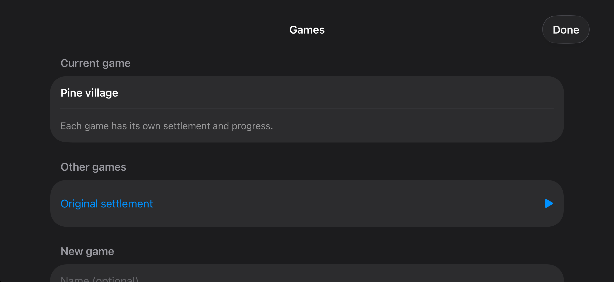
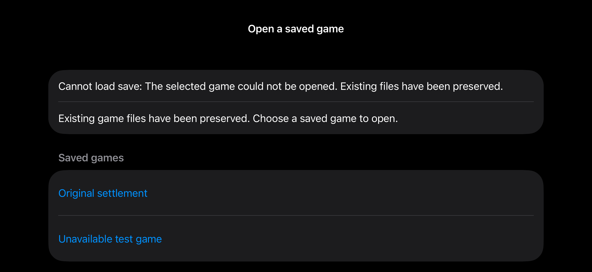
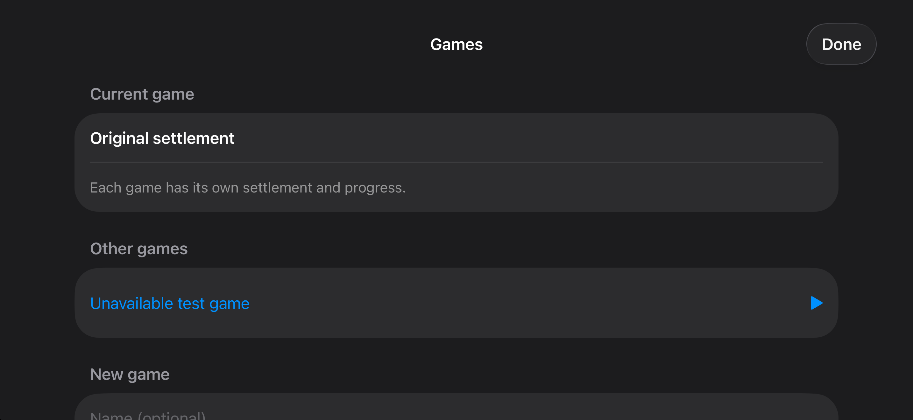

# S1-Saves — independent games and safe recovery

## Physical follow-up — 20 November 2026

Dima requested installation again. Signed product7f5e10c installed after fresh production-validated backup; both saves byte-identical before launch. Normal launch now succeeds. Production GameLibraryStore validates a version1, single-legacy-game index with original selected; SaveStore/GameEngine validate the loaded settlement. Five buildings/15roads, original geometry/map/discoveries/research/reserves/IDs preserved. Existing rewards retained; offline progress earned the knowledge goal. Developer save remains byte-identical after launch. [Current evidence](../testing/s1-saves/device-install-2026-11-20.json). This supersedes the historical locked-device launch/index blocker below. Geography proposal is not active; human gameplay and hardware performance acceptance remain open.

Implemented20November2026; awaiting human acceptance. Final product7f5e10c (review fixes c124568, initial UI7d7608e, library18c758f, metadata c0de0b5). Branch first-era-review preserved. Media697b486/main unchanged. Signed update installed; physical first launch/library initialization is **pending device unlock**. Do not infer a successful physical launch from successful installation or simulator tests.

## Behavior

Games beside Goals/Explore opens a normal-game list with current name, optional new name/default and resume actions. Every game has independent actual starting state and files. The existing settlement remains `legacy` at settlement-v1.json; its developer companion remains at the original suffix. New UUID games use independent directories. Version1 games-index.json is separate from unchanged v5 game envelopes. No delete/reset/cloud or developer scenario in ordinary creation.

Switching cancels transient editors, saves current progress, restores a target off-main, commits index selection and publishes a fresh keyed renderer/session. Current scene activity controls activation even across startup/switch suspension. Regular save failure blocks switching. Corrupt/unsupported metadata is preserved; missing/corrupt registered files never silently become fresh settlements. A valid index offers explicit healthy-game recovery after selected-save failure. Existing targets remain memory-only until selection succeeds, preventing failed attempts from advancing their persisted offline clock. New unregistered candidate files can remain after index IO failure, without deleting any game. Developer mode requires explicit normal return before game management, and each game resumes its own developer companion.

Names and index mechanics are delegated engineering choices in the [reconciled specification](../superpowers/specs/2026-11-19-s1-saves-design.md), not older human quotations. No map/catalog/economy/era/signing/art change. All approved/deferred roadmap IDs remain intact.

## Actual verification

| Check | Result |
|---|---|
| Full core Debug |172 tests pass32.265s at c124568 behavior|
| Full core Release |159 tests pass7.260s at c124568 behavior|
| Release developer exclusions |All five probes pass|
| Full native phone, iPhone17ProMax/iOS26.5 |19 cases pass361.040s|
| Full native mini,A17Pro/iOS18.6 |19 cases pass311.444s|
| Native Pro13M4/iOS18.6 |18-case suite passes303.984s; added recovery case passes6.450s|
| Final error-copy refinement7f5e10c |Two targeted core tests pass (missing/corrupt recovery parameterized); phone recovery passes12.653s|
| Signed build |Debug device build and strict codesign verification pass, existing signing settings|
| Physical update |Fresh production-validated backup, installed; both saves byte-identical pre-launch|
| Physical normal launch/index migration |Blocked by iOS device lock; not verified|

Full core/profile suites precede only the final three-line player-facing error-copy refinement; affected core/native recovery rechecked afterward. No hardware FPS/touch/enjoyment acceptance claimed. Initial full18phone315.492s/mini283.324s results are earlier baselines, not final19-case evidence.

Meaningful tests prove normal construction/research/reward/road histories survive switching while a fresh game lacks them, per-game developer files resume distinct scenarios, UUID selection persists on relaunch, drafts cancel, lifecycle/capped catch-up remains deterministic, concurrent create is blocked, current/index IO failure keeps selection, failed opens preserve target bytes, and corrupt/missing selected games explicitly recover a healthy slot without resetting damaged files. Native flow constructs a real shelter in the original, creates a fresh second game, verifies different guidance after switching, and relaunches the UUID game. A Debug-only missing-slot fixture is confined to fresh UUID temporary roots and exercises actual recovery UI; it compiles out of Release.

One independent final review produced one consequential-fix pass. Failed-open writes reproduced RED→GREEN; recovery APIs were RED before implementation. The root-alias regression already passed the previous implementation; explicit root-entry rejection now documents the invariant. Tests were strengthened after the reviewer identified indistinguishable initial histories. A visual pass corrected confusing temporary-session recovery copy. No repeated review loop.

Commands: `swift test --package-path Packages/GameCore`; add `-c release` for Release. `python3 scripts/verify-developer-release.py`. Native: `xcodebuild test -project Civilization.xcodeproj -scheme Civilization -configuration Debug -destination 'platform=iOS Simulator,id=<profile>' -derivedDataPath /tmp/civilization-s1saves-<profile>-build CODE_SIGNING_ALLOWED=NO`. Profile IDs: phone EC995F2A-534A-4E57-A59C-0DE408729150; mini390CFA90-D4C9-40F9-BA4A-FE3489C20809; Pro7FBB2956-E961-4389-B329-7D2689E96E4F. Pro's additional recovery case uses `-only-testing:CivilizationUITests/RelocationUITests/testMissingSelectedSaveOffersExplicitHealthyGameRecovery`.

Logs: /tmp/civilization-s1saves-reviewed-{debug,release}.log; /tmp/civilization-s1saves-reviewed-full-{phone,mini,pro}.log; /tmp/civilization-s1saves-reviewed-recovery-pro.log; /tmp/civilization-s1saves-recovery-copy-{check,phone}.log. Result bundles reside in each derived directory's Logs/Test. These are actual run records; temp paths are not permanent artifacts.

## Native visual inspection

Actual simulator captures were inspected; no resized/misframed XCTest attachment substituted. Games list/current marker and explicit recovery are readable. Standard Form scroll reveals new-game controls on compact landscape. Original artwork is unchanged and remains subject to separate human acceptance.

## Physical preservation and remaining check

Fresh final backup /tmp/civilization-s1saves-final-device-before/Civilization was validated against current GameEngine/SaveStore before installation. After-install copy /tmp/civilization-s1saves-final-device-after/Civilization validates and has byte-identical normal/developer files. Normal now has5buildings/15roads; developer5buildings/0roads, both river-clearing-v1. This preserves the latest normal progress rather than assuming the earlier4-building backup remains current. Only [comparison metadata](../testing/s1-saves/device-save-preservation.json) is committed; save contents stay local.

Launch request was denied by SBMainWorkspace because the phone is locked. A further read-only copy validates both saves, but no library index exists because launch never occurred. Unlock, retry the normal launch, copy/validate again and confirm a legacy-only index plus normal building/map/road identities and unchanged developer bytes. No uninstall/reset or signing/account changes. Physical touch, sustained performance and human enjoyment remain open.

Next: publish this bounded milestone to GitHub issue1; reconcile S1-Geography exact dimensions, existing-world migration and quarry/cloud/discovery policy for the explicit review gate before affected map code. Then approved environment graphics. No second-era gameplay or automatic scope expansion.
